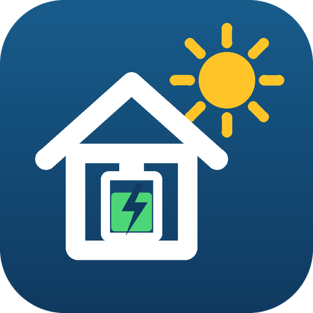

# HomeBatteryAssist

A Home Assistant custom integration that gives insight into your home batteries and energy flows, forecasts what is coming, and plans what your batteries could best do — explained in plain language.

> [!WARNING]
> **Alpha — under active development, not even beta.** Settings, entities and behaviour can still change at any moment; releases are alpha releases. Use it to explore and give feedback, not to rely on.
>
> **In this phase of development** HomeBatteryAssist does not control any physical battery (or any other device): it reads, forecasts and advises. Only *virtual* batteries follow its plans, as a simulation. Controlling batteries itself is the goal; until then it stays read-only for safety and so it does not disturb the integration that controls your battery now; the control layer and a [test control](docs/measuring.md#test-control-switched-off-for-now) per battery are already built, but not active.

🇳🇱 **Nederlands**: HomeBatteryAssist helpt je je thuisbatterij slim in te zetten in Home Assistant: nul op de meter, arbitrage met een dynamisch energiecontract, voorbereid op het einde van salderen in 2027. De documentatie is ook in het Nederlands.

📖 **Documentation (English / Nederlands): https://mvanrijnen.github.io/HomeBatteryAssist/** — with a [step-by-step guide](https://mvanrijnen.github.io/HomeBatteryAssist/getting-started.html).

HomeBatteryAssist measures, forecasts and plans your home batteries, and is built to control them. **For now it only reads, forecasts and advises**, so it runs next to the integration that controls your battery (e.g. Omnibattery) without interfering. It uses the price and PV forecasts you already have, and checks every forecast afterwards against what really happened.

*The dashboard — [all screenshots](docs/screenshots.md) of the dashboard and the configuration.*

## What it does

- **Measures** the grid connection per phase (meters read directly, e.g. HomeWizard P1 or SMA Home Manager, or your own sensors), your batteries (through their own integration; for now read-only), PV, excluded devices such as an EV charger and (optionally) heating/cooling, and from that the house consumption. It checks whether each battery [follows its command](docs/measuring.md#does-the-battery-follow-its-command). *Virtual batteries* show what a (bigger) battery would bring. → [Measuring](docs/measuring.md)
- **Forecasts** the house consumption from your own history, optionally following the weather forecast (a weather entity, KNMI, Weerlive or Open-Meteo) for electric heating or cooling (per room, learning the desired room temperature per day of the week), and takes prices and the PV forecast from your integrations — assuming **no net metering** (as in the Netherlands from 2027). Every forecast is checked afterwards and corrected where it is consistently off. → [Forecasting](docs/forecasting.md)
- **Plans** what the batteries could best do — zero on the meter, arbitrage, time slots, manual or your own planner — within the batteries' and the grid connection's limits, with a periodic full charge, follows the real sun when it differs from the forecast, and compares every plan with no battery. For now as advice (virtual batteries follow it). → [Planning](docs/planning.md)
- **Explains** every plan and every change in plain language, as periods: what happens until when, and why — also what your real battery does by its own control. → [Planning: explanation](docs/planning.md#explanation)
- **Shows** it all on a dashboard in the sidebar. → [Dashboard](docs/dashboard.md) · [Screenshots](docs/screenshots.md)
- **Can be made your own**: the planner, the consumption forecaster, the tariff, the PV forecast source, the PV correction and the spike filter (short peaks such as a kettle: not discharged for, left out of the average) are *modules* — choose a built-in one or add your own, while HomeBatteryAssist keeps the final say. → [Modules](docs/modules.md)

## Installation

### HACS (custom repository)

1. In HACS, open the menu → **Custom repositories**.
2. Add `https://github.com/mvanrijnen/HomeBatteryAssist` with type **Integration**.
3. Install **HomeBatteryAssist** and restart Home Assistant.
4. Go to **Settings → Devices & services → Add integration** and search for **HomeBatteryAssist**.

### Manual

Copy `custom_components/homebatteryassist` into your Home Assistant `config/custom_components/` directory and restart Home Assistant.

Home Assistant 2025.6 or newer is required.

### Prices (recommended for the Netherlands)

For dynamic energy prices HomeBatteryAssist reads a price integration you already have. Tested with **DynTarNL** ([mvanrijnen/ha-dyntarNL](https://github.com/mvanrijnen/ha-dyntarNL)): Dutch dynamic tariffs including the price forecast for the coming days, and from DynTarNL 1.2.0 also the export price (published and forecast; older versions: market price minus the purchase fee). Other sources (Nord Pool, EnergyZero, easyEnergy, …) work too — see [Inputs](docs/inputs.md#prices) for what is read and which settings to choose.

## Configuration

- **Configure** on the integration opens a menu:
  - **Settings**: the main fields on top (history interval, planning horizon, forecast interval, price source, extra price forecast, plan mode, consumption forecaster, tariff, PV forecast), the rest in collapsible sections: export price, solar forecast correction (incl. the PV correction module), planning, limits and reserve, short peaks, full charge, battery temperature, notifications, weather and outdoor temperature. Empty fields show their default value;
  - **Back to default settings**: every setting back to its default; where the prices and PV forecast come from is kept;
  - **Grid connection and meter**: the meter, phases, connection size and sensors.
- **Add** batteries, virtual batteries, PV sources, excluded devices, heating/cooling (optionally with room and outdoor temperature: a zone per room) and time slots under the integration; each can be changed later (including its phase).

## Documentation

The full documentation, in English and Dutch, is at **https://mvanrijnen.github.io/HomeBatteryAssist/**: a [step-by-step guide](https://mvanrijnen.github.io/HomeBatteryAssist/getting-started.html), the [settings reference](https://mvanrijnen.github.io/HomeBatteryAssist/reference.html) and an [FAQ](https://mvanrijnen.github.io/HomeBatteryAssist/faq.html). The same pages are in [`docs/`](docs):

| Page | About |
|---|---|
| [Getting started](docs/getting-started.md) | Step-by-step installation and setup |
| [Settings reference](docs/reference.md) | Every screen, field and explanation, entities and actions |
| [FAQ](docs/faq.md) | Frequently asked questions |
| [Architecture](docs/architecture.md) | Layers, drivers and modules, and where everything is in the code |
| [Measuring](docs/measuring.md) | Grid meters, batteries, virtual batteries, PV sources, excluded devices, house consumption |
| [Inputs](docs/inputs.md) | Everything HomeBatteryAssist reads in one place: grid meter, batteries, prices (DynTarNL roles, tariff, export price), PV forecast, weather, history |
| [Forecasting](docs/forecasting.md) | Planning window, consumption, prices, export price and tariff, PV, accuracy |
| [Planning](docs/planning.md) | Plan modes, rules and limits, full charge, explanations, plan check |
| [Dashboard](docs/dashboard.md) | What each tab shows |
| [Screenshots](docs/screenshots.md) | Every screen of the dashboard and the configuration |
| [Modules](docs/modules.md) | Planners, consumption forecasters, price sources, tariffs, PV forecast sources and PV corrections — built-in and your own |
| [Drivers](docs/drivers.md) | Devices: battery models and readers, meters per brand |
| [Working with other integrations](docs/integration.md) | Sensors, actions, events, logging, notifications |
| [Development](docs/development.md) | Tests, code structure, contributing |

## License

[MIT](LICENSE)
