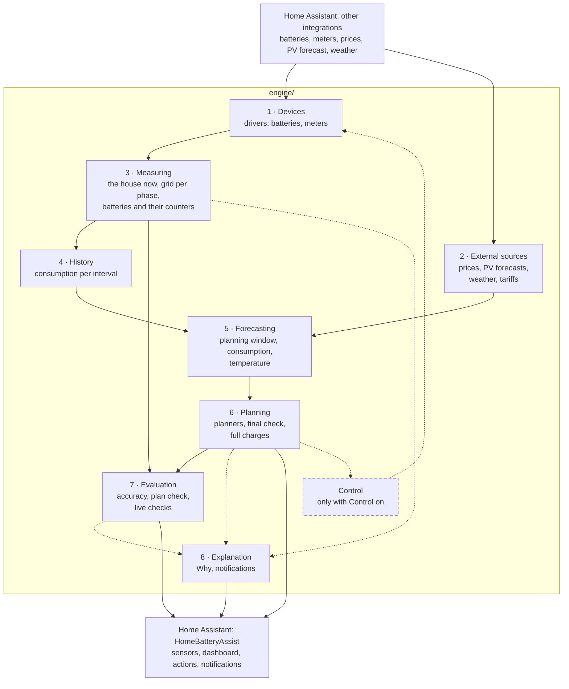
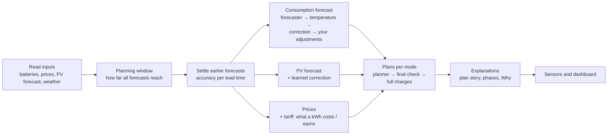
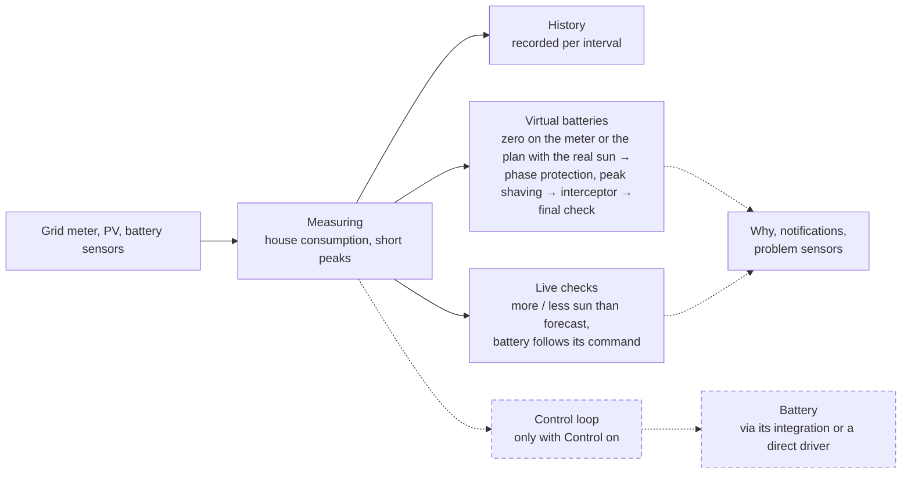
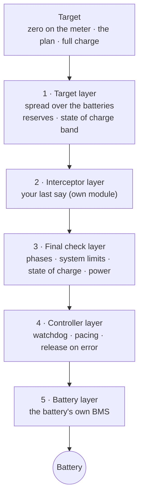

# Architecture: layers, drivers and modules

HomeBatteryAssist is built in layers. Data flows one way, from the devices to the explanation; a layer only uses the layers below it.

| # | Layer | What it does | Folder |
|---|---|---|---|
| 1 | **Devices** | Reads the physical devices, and controls batteries when you switch control on | `engine/devices/` |
| 2 | **External sources** | Prices, PV forecasts, tariffs | `engine/sources/` |
| 3 | **Measuring** | The house *now*: consumption, grid per phase, battery states and counters | `engine/measure/` |
| 4 | **History** | The past: consumption per interval, import of older data | `engine/history/` |
| 5 | **Forecasting** | The future: the planning window and the consumption forecast | `engine/forecast/` |
| 6 | **Planning** | Deciding: planners, the final check, full charges, phase limits, several batteries | `engine/planning/` |
| 7 | **Evaluation** | Afterwards: forecast accuracy, plan versus what happened | `engine/evaluation/` |
| 8 | **Explanation** | The *Why* texts and notifications | `engine/explain/` |
| – | **Home Assistant** | Entities, dashboard, settings, actions | package root (`output/`, `frontend/`, `config_flow.py`, …) |

`engine/coordinator.py` runs one cycle through the layers (by default every 15 minutes, and when new prices arrive).

## At a glance

How the layers hang together: data comes in at the top and flows down. Dotted arrows: messages for *Why*, and the control (only with *Control on*, dashed box).



### One forecast cycle

What `engine/coordinator.py` does every 15 minutes and when new prices arrive:



### Live, every few seconds

What happens between two cycles, on every new measurement:



## Drivers and modules

- **Drivers** connect HomeBatteryAssist to *devices* (layer 1). They are part of the code; a new one is added through a pull request. → [Drivers](drivers.md)
- **Modules** are the swappable parts of the *other* layers. The built-in ones live in their layer; advanced users can add their own in `/config/homebatteryassist/<kind>/` and choose them in the settings, while HomeBatteryAssist keeps the final say. → [Modules](modules.md)

Every extension point has the same shape: `base.py` (the interface), `template.py` (an example, never offered) and one file per built-in variant.

## Folder map

```
custom_components/homebatteryassist/
├── __init__.py, config_flow.py, services.py, diagnostics.py, sensor.py, button.py
├── output/            entities and the dashboard's data
├── frontend/          the dashboard (panel.js)
├── strings.json, translations/
└── engine/
    ├── coordinator.py     one cycle through the layers
    ├── db_store.py        storage of the big stores (JSON file or a database)
    ├── control/           control_loop.py (the control loop, only with Control on),
    │                      battery_controller.py (safety layer 4), control_test.py,
    │                      reader_driver.py (LinkDriver / ReaderDriver), pd_controller.py,
    │                      export_limiter.py (prepared, sends nothing),
    │                      interceptors/ (base.py, template.py, pass_through.py)
    ├── units.py           unit conversion
    ├── own_modules.py     loading own modules from /config
    ├── devices/           1  drivers
    │   ├── batteries/     base.py, template.py, virtual.py (simulation), recognition.py,
    │   │                  control_quality.py, response.py,
    │   │                  integrations/ (entity_reader.py, omnibattery_integration.py,
    │   │                  marstek_modbus_integration.py),
    │   │                  direct/ (base.py, modbus_driver.py, http_driver.py, mqtt_driver.py
    │   │                  — chosen per battery, direct/link.py),
    │   │                  one folder per brand: models (brand → range → type) + direct driver:
    │   │                  marstek/, anker/, huawei/, zendure/, sessy/, indevolt/, hoymiles/
    │   ├── inverters/     prepared, not used: base.py, template.py, sunspec_modbus.py,
    │   │                  sma_home_manager.py, sma_modbus.py, sma_storage_x.py
    │   ├── transports/    modbus_tcp.py (own small Modbus TCP client)
    │   └── meters/        base.py, template.py, homewizard.py, homewizard_v2.py, sma.py,
    │                      shelly.py, iammeter.py, direct_reading.py, discovery.py,
    │                      via_ha_integration.py
    ├── sources/           2  modules
    │   ├── prices/        base.py, template.py, price_points.py, dyntarnl.py,
    │   │                  ha_price_actions.py, sensor_attributes.py, regional.py,
    │   │                  block_tariff.py, price_forecasts.py, in_development/ (tibber.py)
    │   ├── pv_forecasts/  base.py, template.py, solar_forecast_integrations.py,
    │   │                  energy_dashboard_platform.py
    │   ├── tariffs/       base.py, template.py, as_price_source.py, market_plus_costs.py
    │   └── weather/       base.py, template.py, ha_weather_entity.py, knmi_integration.py,
    │                      weerlive_api.py, open_meteo.py (optional)
    ├── measure/           3  house_measurement.py, battery_monitor.py, heating_zones.py,
    │                         recorder_check.py,
    │                         spike_filters/ (base.py, template.py, short_peaks.py)
    ├── history/           4  consumption_history.py, history_import.py, chart_series.py,
    │                         temperature_import.py, spikes.py
    ├── forecast/          5  planning_window.py, consumption_forecast.py, intraday.py,
    │                         user_adjustments.py, phase_shares.py, temperature_effect.py,
    │                         forecasters/ (base.py, template.py, weekday_hour_profile.py,
    │                                       same_time_last_weeks.py)
    ├── planning/          6  battery_plan.py (final check), full_charge.py, phase_limit.py,
    │                         battery_distribution.py, time_slots.py, export_limit.py,
    │                         ev_advice.py,
    │                         planners/ (base.py, template.py, zero_on_meter.py, arbitrage.py)
    ├── evaluation/        7  forecast_accuracy.py, plan_check.py, unexpected_surplus.py,
    │                         command_check.py, battery_temperature.py, price_surprise.py,
    │                         pv_corrections/ (base.py, template.py, hour_and_level.py, lead_time.py)
    └── explain/           8  messages.py, plan_story.py, plan_phases.py, plan_summary.py,
                              decision_log.py, activity_log.py, notifications.py, money.py,
                              input_report.py
```

## Batteries: model and reader

A battery driver has two parts:

- a **model** — what the battery *is* — organised by inheritance as **brand → type range → type**: `marstek/__init__.py` (Marstek) → `marstek/venus.py` (Venus) → `marstek/venus_e_v3.py` (Venus E v3). A type inherits from its range and brand and only sets its own specifications (capacity, power, usable part, rated cycles, warranty);
- a **reader** — how the battery is *read* — one per integration that exposes batteries (`integrations/omnibattery_integration.py`, `integrations/marstek_modbus_integration.py`).

So one battery type can be read through several integrations. The **virtual battery** (`virtual.py`) is a simulated device that follows the plan.

## Control layer {#control-layer-built-not-active}

HomeBatteryAssist controls batteries only when you switch it on (setting *Control on*, and per battery *Controlled by HomeBatteryAssist*; both off by default). Every command goes through a controller per battery (`engine/control/battery_controller.py`), built so the safety is in place before anything is sent:

- a **master switch**, off by default: nothing is sent while it is off; only the control loop and the test control turn it on, and only when you switched them on;
- **always release** control to the battery's own logic on stop, reload, restart and every error;
- a **watchdog**: without a new command for 2 minutes, control is released;
- **refresh** the last command for batteries that drop out of external control otherwise;
- **throttle**: at least 5 s between commands for every battery (a driver may ask for longer) and a deadband (going idle is never held back; direction changes are throttled too); a NaN power releases; a failed release is retried every tick until it succeeds;
- **idle = release** for batteries where 0 W is not idle (e.g. a Huawei inverter keeps limiting PV);
- the **limits** of the device and of the caller are always enforced.

A test (`tests/test_read_only.py`) fails as soon as code outside the drivers and the control layer calls a write method, creates a controller, enables a direct driver or calls a Home Assistant action that changes a device, or as soon as any switch is on by default.

Each [direct driver](drivers.md#direct-battery-drivers) states its own control needs; the controller enforces them.

The **control loop** (`engine/control/control_loop.py`) runs only with the setting *Control on* (section *Control*, default off), and only for batteries marked *Controlled by HomeBatteryAssist* in their form (default off). It is the virtual battery simulator on the controlled real batteries, so it has the same targets every round (default 5 s, at once on a large jump or an overload): zero on the meter (never for excluded devices or random short peaks) or the plan, as the active planner module says (one choice: *Zero on the meter* or *Arbitrage*), full charges, spread over the batteries, phase protection and peak shaving, the interceptor, state of charge and system limits. Zero on the meter on a real battery steers on the meter alone: each round half of what the meter shows on top of the previous command (a battery's own power reading comes seconds late and must not steer), the direction only turning for at least 100 W; if charge and discharge still alternate 4 times within a minute, the control pauses for 10 minutes (batteries released). It works on the measured grid without the controlled batteries, and gives each battery its power through its controller, over its direct connection or else its integration. A battery goes back to its own control while a test runs on it, while it does not follow its command, while its state of charge or power is unknown, or while the grid measurement is gone, and on stop; *Why* tells each change (*control_started*, *control_held*, *control_resumed*, *control_failed*, *control_stopped*), and *control_not_possible* when a battery is set to be controlled but cannot be reached for writing.

**Activity log.** Every minute each real battery is looked at (`engine/explain/activity_log.py`): what it did (charging from the sun or from the grid, discharging, idle), who decided (HomeBatteryAssist with zero on the meter or the plan, a test, the battery's own control, or an incident such as not following its command or a lost connection), whether that matches the plan, and why, as a reason per period with the minutes per reason. The periods are kept for 30 days, shown in the dashboard tab *Log* and can be exported as CSV.

**Test control (off by default).** Each real battery has *Test: charge*, *Test: discharge* and *Test: stop* (buttons), a *Test power* and a *Test duration* (numbers) and a *Test control* status, to test controlling a battery by hand before any automatic control (`engine/control/control_test.py`, through `reader_driver.py`: `LinkDriver` over the battery's direct connection, else `ReaderDriver` through its integration). A test charges or discharges at the test power for the test duration and then always hands the battery back to its own control; it stops at once when the battery is full or at its lowest allowed state of charge, does not follow the command, on an error, by *Test: stop* and on reload. It is off unless the setting *Test control on* is on (default `CONTROL_TEST_ALLOWED = False`, checked by a test): a button only tells *Why* so, nothing is sent.

## Safety layers {#safety-layers}

Every power HomeBatteryAssist gives a battery — by the control, a full charge or a test — passes five layers in this order. Each layer may only make the power smaller or stop it, never bigger; a later layer always wins.



| Layer | Where | What it guards |
|---|---|---|
| **1 · Target layer** | `virtual.py` `_targets` (control: the same) | Spreads the total over the batteries (`battery_distribution`), each between its floor and ceiling: floor = the highest of its *Minimum charge*, the *Reserve*, the *Night reserve* (from sunset to sunrise) and the *Peak reserve* (only peak shaving goes below it); ceiling = its *Maximum charge*, lower while the charge hysteresis holds it after a full charge. Never one battery charging while another discharges. Zero on the meter never discharges for excluded devices or a random short peak. |
| **2 · Interceptor layer** | `engine/control/interceptors/` | Your own module gets the proposal per battery and may approve, limit (less, same direction), hold back or release it; nonsense or a failure counts as approved. It can never make a power bigger or turn it around, and it cannot undo phase protection or peak shaving. Built in: *none* (approves everything). |
| **3 · Final check layer** | `virtual.py` `_phase_limited`, `system_limited`, `limit_power` | HomeBatteryAssist's own check, after the interceptor, always wins: the fuses per phase (current, with a margin), the system's max charge / discharge power, and per battery its max power and its state of charge band (never charging above its maximum, never discharging below its minimum). |
| **4 · Controller layer** | `engine/control/battery_controller.py` | Per battery, what is actually sent: the device's limits again, at most one new command every few seconds and only a real change (deadband), the command repeated when the battery needs it, a **watchdog** (no new command for 2 minutes = release), and **release on every error**, stop, reload and restart. With the control: release while a test runs, while the battery does not follow its command, while its state or the grid measurement is unknown, and a pause of 10 minutes when charge and discharge alternate too often. |
| **5 · Battery layer** | the battery itself | The battery's own protection (BMS): its own minimum and maximum state of charge (a Marstek Venus: 12–100 %), temperature and cell protection. HomeBatteryAssist sets its *Minimum charge* to at least this, so the plans count on what the battery really gives. |

## Meters

One file per brand (`homewizard.py`, `homewizard_v2.py`, `sma.py`, `shelly.py`, `iammeter.py`), sharing `direct_reading.py` (read about once a second or pushed, a value going stale after 10 s; 25 s for HomeWizard API v2). Meters can also be read through their own Home Assistant integration (`via_ha_integration.py`).
