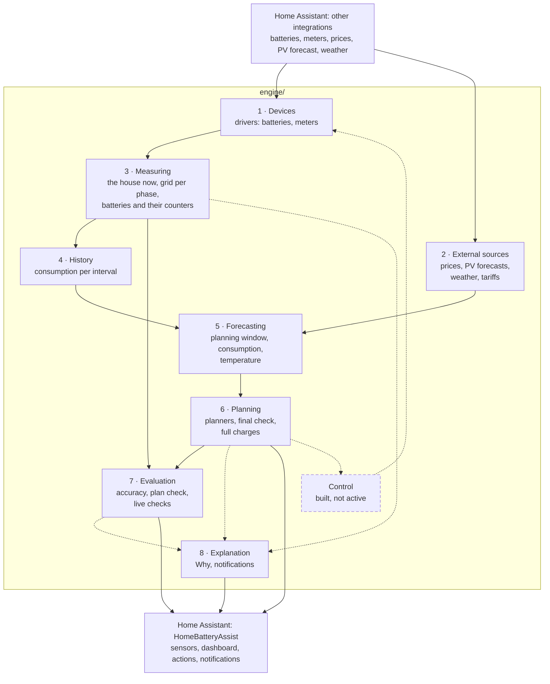
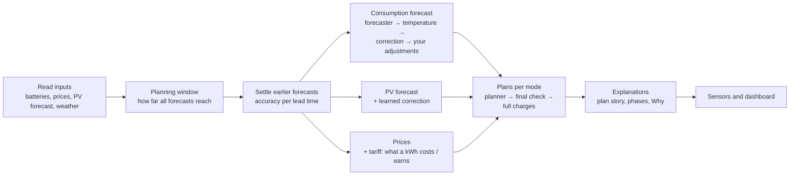
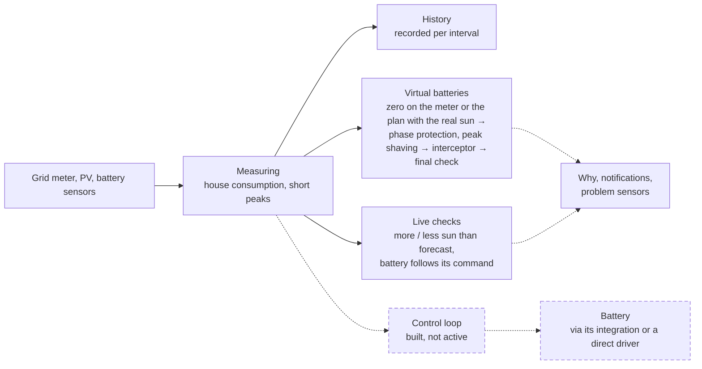

# Architecture: layers, drivers and modules

HomeBatteryAssist is built in layers. Data flows one way, from the devices to the explanation; a layer only uses the layers below it.

| # | Layer | What it does | Folder |
|---|---|---|---|
| 1 | **Devices** | Talks to the physical devices — for now read-only | `engine/devices/` |
| 2 | **External sources** | Prices, PV forecasts, tariffs | `engine/sources/` |
| 3 | **Measuring** | The house *now*: consumption, grid per phase, battery states and counters | `engine/measure/` |
| 4 | **History** | The past: consumption per interval, import of older data | `engine/history/` |
| 5 | **Forecasting** | The future: the planning window and the consumption forecast | `engine/forecast/` |
| 6 | **Planning** | Deciding: planners, the final check, full charges, phase limits, several batteries | `engine/planning/` |
| 7 | **Evaluation** | Afterwards: forecast accuracy, plan versus what happened | `engine/evaluation/` |
| 8 | **Explanation** | The *Why* texts and notifications | `engine/explain/` |
| – | **Home Assistant** | Entities, dashboard, settings, actions | package root (`output/`, `frontend/`, `config_flow.py`, …) |

`engine/coordinator.py` runs one cycle through the layers (by default every 15 minutes, and when new prices arrive).

## At a glance

How the layers hang together: data comes in at the top and flows down. Dotted arrows: messages for *Why*, and the control that is built but not active yet (dashed box).



### One forecast cycle

What `engine/coordinator.py` does every 15 minutes and when new prices arrive:



### Live, every few seconds

What happens between two cycles, on every new measurement:



## Drivers and modules

- **Drivers** connect HomeBatteryAssist to *devices* (layer 1). They are part of the code; a new one is added through a pull request. → [Drivers](drivers.md)
- **Modules** are the swappable parts of the *other* layers. The built-in ones live in their layer; advanced users can add their own in `/config/homebatteryassist/<kind>/` and choose them in the settings, while HomeBatteryAssist keeps the final say. → [Modules](modules.md)

Every extension point has the same shape: `base.py` (the interface), `template.py` (an example, never offered) and one file per built-in variant.

## Folder map

```
custom_components/homebatteryassist/
├── __init__.py, config_flow.py, services.py, diagnostics.py, sensor.py, button.py
├── output/            entities and the dashboard's data
├── frontend/          the dashboard (panel.js)
├── strings.json, translations/
└── engine/
    ├── coordinator.py     one cycle through the layers
    ├── control/           battery_controller.py — built, not active;
    │                      control_loop.py — written out as comment;
    │                      interceptors/ (base.py, template.py, pass_through.py)
    ├── units.py           unit conversion
    ├── own_modules.py     loading own modules from /config
    ├── devices/           1  drivers
    │   ├── batteries/     base.py, template.py, virtual.py (simulation), recognition.py,
    │   │                  integrations/ (entity_reader.py, omnibattery_integration.py,
    │   │                  marstek_modbus_integration.py),
    │   │                  direct/ (base.py, modbus_driver.py, http_driver.py, mqtt_driver.py
    │   │                  — prepared, not used),
    │   │                  one folder per brand: models (brand → range → type) + direct driver:
    │   │                  marstek/, anker/, huawei/, zendure/, sessy/, indevolt/, hoymiles/
    │   ├── transports/    modbus_tcp.py (own small Modbus TCP client)
    │   └── meters/        base.py, template.py, homewizard.py, sma.py, shelly.py,
    │                      iammeter.py, direct_reading.py, discovery.py,
    │                      via_ha_integration.py
    ├── sources/           2  modules
    │   ├── prices/        base.py, template.py, price_points.py, dyntarnl.py,
    │   │                  ha_price_actions.py, sensor_attributes.py, regional.py,
    │   │                  price_forecasts.py, in_development/ (tibber.py)
    │   ├── pv_forecasts/  base.py, template.py, solar_forecast_integrations.py,
    │   │                  energy_dashboard_platform.py
    │   ├── tariffs/       base.py, template.py, as_price_source.py
    │   └── weather/       base.py, template.py, ha_weather_entity.py, knmi_integration.py,
    │                      weerlive_api.py, open_meteo.py (optional)
    ├── measure/           3  house_measurement.py, battery_monitor.py, heating_zones.py,
    │                         spike_filters/ (base.py, template.py, short_peaks.py)
    ├── history/           4  consumption_history.py, history_import.py, chart_series.py,
    │                         temperature_import.py, spikes.py
    ├── forecast/          5  planning_window.py, consumption_forecast.py,
    │                         user_adjustments.py, phase_shares.py, temperature_effect.py,
    │                         forecasters/ (base.py, template.py, weekday_hour_profile.py,
    │                                       same_time_last_weeks.py)
    ├── planning/          6  battery_plan.py (final check), full_charge.py, phase_limit.py,
    │                         battery_distribution.py, time_slots.py,
    │                         planners/ (base.py, template.py, zero_on_meter.py, arbitrage.py)
    ├── evaluation/        7  forecast_accuracy.py, plan_check.py, unexpected_surplus.py,
    │                         pv_corrections/ (base.py, template.py, hour_and_level.py, lead_time.py)
    └── explain/           8  messages.py, plan_story.py, decision_log.py, notifications.py
```

## Batteries: model and reader

A battery driver has two parts:

- a **model** — what the battery *is* — organised by inheritance as **brand → type range → type**: `marstek/__init__.py` (Marstek) → `marstek/venus.py` (Venus) → `marstek/venus_e_v3.py` (Venus E v3). A type inherits from its range and brand and only sets its own specifications (capacity, power, usable part, rated cycles, warranty);
- a **reader** — how the battery is *read* — one per integration that exposes batteries (`integrations/omnibattery_integration.py`, `integrations/marstek_modbus_integration.py`).

So one battery type can be read through several integrations. The **virtual battery** (`virtual.py`) is a simulated device that follows the plan.

## Control layer (built, not active)

In this phase of development HomeBatteryAssist does not control batteries yet. The control layer (`engine/control/battery_controller.py`) is built beforehand, so the safety is in place before anything is controlled:

- a **master switch**, off by default — nothing is sent while it is off, and nothing in HomeBatteryAssist turns it on;
- **always release** control to the battery's own logic on stop, reload, restart and every error;
- a **watchdog**: without a new command for 2 minutes, control is released;
- **refresh** the last command for batteries that drop out of external control otherwise;
- **throttle**: at least 5 s between commands for every battery (a driver may ask for longer) and a deadband (going idle is never held back; direction changes are throttled too); a NaN power releases; a failed release is retried every tick until it succeeds;
- **idle = release** for batteries where 0 W is not idle (e.g. a Huawei inverter keeps limiting PV);
- the **limits** of the device and of the caller are always enforced.

A test (`tests/test_read_only.py`) fails as soon as code outside the drivers and this layer calls a write method, creates a controller, enables a direct driver or calls a Home Assistant action that changes a device.

Each [direct driver](drivers.md#direct-battery-drivers--prepared-not-used) states its own control needs; the controller enforces them.

The **control loop** (`engine/control/control_loop.py`) is written out completely, but as comment: no line of it runs, and a test checks that the file has no active code. Once active it runs every round (default 5 s, at once on a large jump or an overload) next to the virtual batteries, on the same targets — full charge, the plan's power or zero on the meter (never for excluded devices or random short peaks), spread over the batteries, phase protection and peak shaving, state of charge limits — and gives each battery its power through its controller, via the integration it is linked with (e.g. Omnibattery's manual mode) or an enabled direct driver. The steps to activate it are listed at the top of the file.

**Test control (built, switched off).** Each real battery has *Test: charge*, *Test: discharge* and *Test: stop* (buttons), a *Test power* and a *Test duration* (numbers) and a *Test control* status, to test controlling a battery by hand before any automatic control (`engine/control/control_test.py`, through `reader_driver.py`). A test charges or discharges at the test power for the test duration through the battery's integration and then always hands the battery back to its own control; it stops at once when the battery is full or at its lowest allowed state of charge, does not follow the command, on an error, by *Test: stop* and on reload. In this phase it is switched off (`CONTROL_TEST_ALLOWED = False`, checked by a test): a button only tells *Why* so, nothing is sent.

## Meters

One file per brand (`homewizard.py`, `sma.py`, `shelly.py`, `iammeter.py`), sharing `direct_reading.py` (reading about once a second, a value going stale). Meters can also be read through their own Home Assistant integration (`via_ha_integration.py`).
