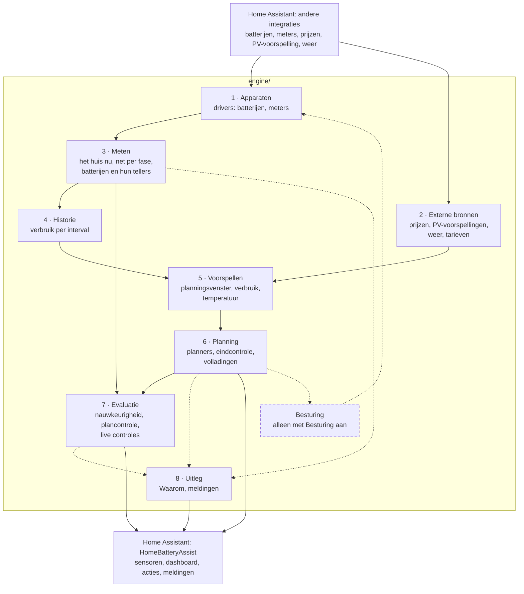
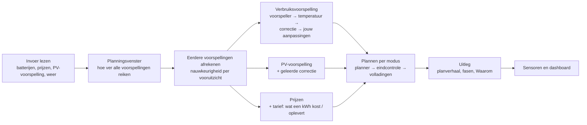
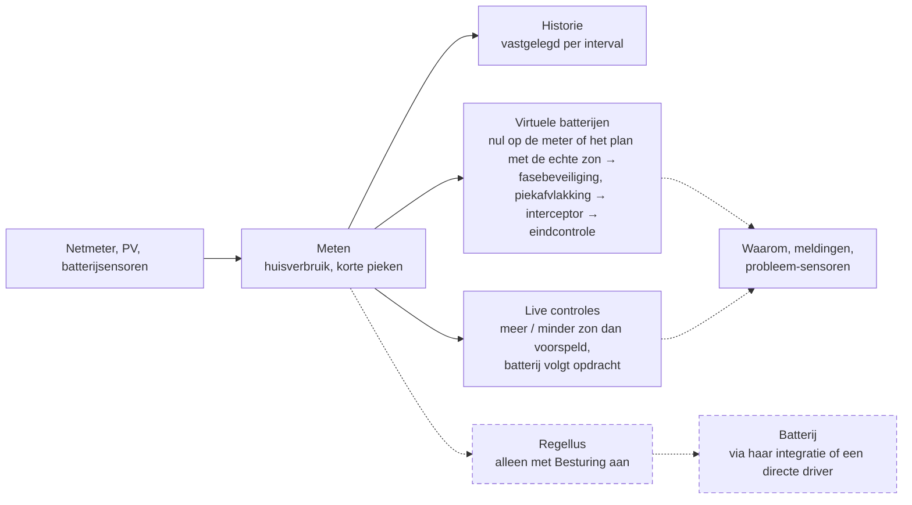
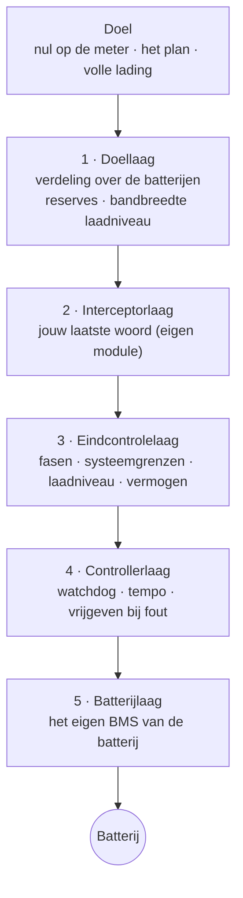

# Architectuur: lagen, drivers en modules {#architecture-layers-drivers-and-modules}

HomeBatteryAssist is in lagen opgebouwd. Gegevens stromen één kant op, van de apparaten naar de uitleg; een laag gebruikt alleen de lagen eronder.

| # | Laag | Wat ze doet | Map |
|---|---|---|---|
| 1 | **Apparaten** | Leest de fysieke apparaten, en stuurt batterijen aan als je de besturing aanzet | `engine/devices/` |
| 2 | **Externe bronnen** | Prijzen, PV-voorspellingen, tarieven | `engine/sources/` |
| 3 | **Meten** | Het huis *nu*: verbruik, net per fase, batterijtoestanden en tellers | `engine/measure/` |
| 4 | **Historie** | Het verleden: verbruik per interval, import van oudere gegevens | `engine/history/` |
| 5 | **Voorspellen** | De toekomst: het planningsvenster en de verbruiksvoorspelling | `engine/forecast/` |
| 6 | **Planning** | Beslissen: planners, de eindcontrole, volladingen, fasegrenzen, meerdere batterijen | `engine/planning/` |
| 7 | **Evaluatie** | Achteraf: nauwkeurigheid van voorspellingen, plan tegenover wat er gebeurde | `engine/evaluation/` |
| 8 | **Uitleg** | De *Waarom*-teksten en meldingen | `engine/explain/` |
| – | **Home Assistant** | Entiteiten, dashboard, instellingen, acties | pakketroot (`output/`, `frontend/`, `config_flow.py`, …) |

`engine/coordinator.py` doorloopt de lagen in één cyclus (standaard elke 15 minuten, en wanneer er nieuwe prijzen binnenkomen).

## In één oogopslag {#at-a-glance}

Hoe de lagen samenhangen: gegevens komen bovenaan binnen en stromen naar beneden. Gestippelde pijlen: berichten voor *Waarom*, en de besturing (alleen met *Besturing aan*, gestreept vak).



### Eén voorspelcyclus {#one-forecast-cycle}

Wat `engine/coordinator.py` elke 15 minuten doet, en wanneer er nieuwe prijzen binnenkomen:



### Live, om de paar seconden {#live-every-few-seconds}

Wat er tussen twee cycli gebeurt, bij elke nieuwe meting:



## Drivers en modules {#drivers-and-modules}

- **Drivers** verbinden HomeBatteryAssist met *apparaten* (laag 1). Ze maken deel uit van de code; een nieuwe voeg je toe via een pull request. → [Drivers](drivers.md)
- **Modules** zijn de verwisselbare onderdelen van de *andere* lagen. De ingebouwde staan in hun laag; gevorderde gebruikers kunnen eigen modules toevoegen in `/config/homebatteryassist/<kind>/` en die in de instellingen kiezen, terwijl HomeBatteryAssist het laatste woord houdt. → [Modules](modules.md)

Elk uitbreidingspunt heeft dezelfde vorm: `base.py` (de interface), `template.py` (een voorbeeld, nooit aangeboden) en één bestand per ingebouwde variant.

## Mappenoverzicht {#folder-map}

```
custom_components/homebatteryassist/
├── __init__.py, config_flow.py, services.py, diagnostics.py, sensor.py, button.py
├── output/            entities and the dashboard's data
├── frontend/          the dashboard (panel.js)
├── strings.json, translations/
└── engine/
    ├── coordinator.py     one cycle through the layers
    ├── db_store.py        storage of the big stores (JSON file or a database)
    ├── control/           control_loop.py (the control loop, only with Control on),
    │                      battery_controller.py (safety layer 4), control_test.py,
    │                      reader_driver.py (LinkDriver / ReaderDriver), pd_controller.py,
    │                      export_limiter.py (prepared, sends nothing),
    │                      interceptors/ (base.py, template.py, pass_through.py)
    ├── units.py           unit conversion
    ├── own_modules.py     loading own modules from /config
    ├── devices/           1  drivers
    │   ├── batteries/     base.py, template.py, virtual.py (simulation), recognition.py,
    │   │                  control_quality.py, response.py,
    │   │                  integrations/ (entity_reader.py, omnibattery_integration.py,
    │   │                  marstek_modbus_integration.py),
    │   │                  direct/ (base.py, modbus_driver.py, http_driver.py, mqtt_driver.py
    │   │                  — chosen per battery, direct/link.py),
    │   │                  one folder per brand: models (brand → range → type) + direct driver:
    │   │                  marstek/, anker/, huawei/, zendure/, sessy/, indevolt/, hoymiles/
    │   ├── inverters/     prepared, not used: base.py, template.py, sunspec_modbus.py,
    │   │                  sma_home_manager.py, sma_modbus.py, sma_storage_x.py
    │   ├── transports/    modbus_tcp.py (own small Modbus TCP client)
    │   └── meters/        base.py, template.py, homewizard.py, homewizard_v2.py, sma.py,
    │                      shelly.py, iammeter.py, direct_reading.py, discovery.py,
    │                      via_ha_integration.py
    ├── sources/           2  modules
    │   ├── prices/        base.py, template.py, price_points.py, dyntarnl.py,
    │   │                  ha_price_actions.py, sensor_attributes.py, regional.py,
    │   │                  block_tariff.py, price_forecasts.py, in_development/ (tibber.py)
    │   ├── pv_forecasts/  base.py, template.py, solar_forecast_integrations.py,
    │   │                  energy_dashboard_platform.py
    │   ├── tariffs/       base.py, template.py, as_price_source.py, market_plus_costs.py
    │   └── weather/       base.py, template.py, ha_weather_entity.py, knmi_integration.py,
    │                      weerlive_api.py, open_meteo.py (optional)
    ├── measure/           3  house_measurement.py, battery_monitor.py, heating_zones.py,
    │                         recorder_check.py,
    │                         spike_filters/ (base.py, template.py, short_peaks.py)
    ├── history/           4  consumption_history.py, history_import.py, chart_series.py,
    │                         temperature_import.py, spikes.py
    ├── forecast/          5  planning_window.py, consumption_forecast.py, intraday.py,
    │                         user_adjustments.py, phase_shares.py, temperature_effect.py,
    │                         forecasters/ (base.py, template.py, weekday_hour_profile.py,
    │                                       same_time_last_weeks.py)
    ├── planning/          6  battery_plan.py (final check), full_charge.py, phase_limit.py,
    │                         battery_distribution.py, time_slots.py, export_limit.py,
    │                         ev_advice.py,
    │                         planners/ (base.py, template.py, zero_on_meter.py, arbitrage.py)
    ├── evaluation/        7  forecast_accuracy.py, plan_check.py, unexpected_surplus.py,
    │                         command_check.py, battery_temperature.py, price_surprise.py,
    │                         pv_corrections/ (base.py, template.py, hour_and_level.py, lead_time.py)
    └── explain/           8  messages.py, plan_story.py, plan_phases.py, plan_summary.py,
                              decision_log.py, activity_log.py, notifications.py, money.py,
                              input_report.py
```

## Batterijen: model en lezer {#batteries-model-and-reader}

Een batterijdriver bestaat uit twee delen:

- een **model** — wat de batterij *is* — geordend via overerving als **merk → typereeks → type**: `marstek/__init__.py` (Marstek) → `marstek/venus.py` (Venus) → `marstek/venus_e_v3.py` (Venus E v3). Een type erft van zijn reeks en merk en legt alleen zijn eigen specificaties vast (capaciteit, vermogen, bruikbaar deel, nominale cycli, garantie);
- een **lezer** — hoe de batterij *gelezen* wordt — één per integratie die batterijen beschikbaar stelt (`integrations/omnibattery_integration.py`, `integrations/marstek_modbus_integration.py`).

Eén batterijtype kan dus via meerdere integraties gelezen worden. De **virtuele batterij** (`virtual.py`) is een gesimuleerd apparaat dat het plan volgt.

## Regellaag {#control-layer-built-not-active}

HomeBatteryAssist stuurt batterijen alleen aan als je dat aanzet (instelling *Besturing aan*, en per batterij *Aangestuurd door HomeBatteryAssist*; beide standaard uit). Elke opdracht gaat door een controller per batterij (`engine/control/battery_controller.py`), zo gebouwd dat de beveiliging op orde is voordat er iets verstuurd wordt:

- een **hoofdschakelaar**, standaard uit: zolang die uit staat wordt er niets verstuurd; alleen de regellus en de testbesturing zetten hem aan, en alleen als jij die hebt aangezet;
- **altijd vrijgeven**: de regie gaat terug naar de eigen logica van de batterij bij stoppen, herladen, herstarten en elke fout;
- een **watchdog**: komt er 2 minuten geen nieuw commando, dan wordt de regie vrijgegeven;
- **verversen** van het laatste commando voor batterijen die anders uit externe aansturing vallen;
- **afremmen**: minstens 5 s tussen commando's voor elke batterij (een driver kan om langer vragen) en een dode band (naar rust gaan wordt nooit tegengehouden; richtingwisselingen worden ook afgeremd); een ongeldig vermogen (NaN) geeft vrij; een mislukte vrijgave wordt elke tik opnieuw geprobeerd tot die lukt;
- **rust = vrijgeven** voor batterijen waarbij 0 W geen rust is (bijv. een Huawei-omvormer blijft dan PV begrenzen);
- de **grenzen** van het apparaat en van de aanroeper worden altijd afgedwongen.

Een test (`tests/test_read_only.py`) faalt zodra code buiten de drivers en de regellaag een schrijfmethode aanroept, een controller aanmaakt, een directe driver inschakelt of een Home Assistant-actie aanroept die een apparaat verandert, of zodra een schakelaar standaard aan staat.

Elke [directe driver](drivers.md#direct-battery-drivers) geeft zijn eigen eisen voor aansturing aan; de controller dwingt die af.

De **regellus** (`engine/control/control_loop.py`) draait alleen met de instelling *Besturing aan* (onderdeel *Besturing*, standaard uit), en alleen voor batterijen met *Aangestuurd door HomeBatteryAssist* in hun formulier (standaard uit). Het is de simulator van de virtuele batterijen op de aangestuurde echte batterijen, dus hij heeft elke ronde dezelfde doelen (standaard 5 s, direct bij een grote sprong of overbelasting): nul op de meter (nooit voor uitgesloten apparaten of willekeurige korte pieken) of het plan, zoals de actieve planningsmodule zegt (één keuze: *Nul op de meter* of *Arbitrage*), volle ladingen, verdeeld over de batterijen, fasebeveiliging en peak shaving, de interceptor, grenzen voor het laadniveau en het systeem. Nul op de meter op een echte batterij stuurt alleen op de meter: elke ronde de helft van wat de meter toont bovenop de vorige opdracht (de eigen vermogensmeting van een batterij komt seconden te laat en mag niet sturen), de richting draait alleen om bij minstens 100 W; wisselen laden en ontladen toch 4 keer binnen een minuut, dan pauzeert de besturing 10 minuten (batterijen vrijgegeven). Hij werkt op het gemeten net zonder de aangestuurde batterijen, en geeft elke batterij haar vermogen via haar controller, over haar directe verbinding of anders haar integratie. Een batterij gaat terug naar haar eigen sturing zolang er een test op loopt, ze haar opdracht niet volgt, haar laadniveau of vermogen onbekend is of de netmeting weg is, en bij stoppen; *Waarom* meldt elke wissel (*control_started*, *control_held*, *control_resumed*, *control_failed*, *control_stopped*), en *control_not_possible* als een batterij aangestuurd moet worden maar niet te bereiken is om te schrijven.

**Activiteitenlog.** Elke minuut wordt elke echte batterij bekeken (`engine/explain/activity_log.py`): wat ze deed (laden uit de zon of uit het net, ontladen, rust), wie besliste (HomeBatteryAssist met nul op de meter of het plan, een test, de eigen sturing van de batterij, of een incident zoals haar opdracht niet volgen of een verbroken verbinding), of dat klopt met het plan, en waarom, als reden per periode met de minuten per reden. De periodes worden 30 dagen bewaard, getoond in het dashboardtabblad *Log* en zijn als CSV te exporteren.

**Testbesturing (standaard uit).** Elke echte batterij heeft *Test: laden*, *Test: ontladen* en *Test: stoppen* (knoppen), een *Testvermogen* en een *Testduur* (getallen) en een status *Testbesturing*, om het aansturen van een batterij met de hand te testen vóór elke automatische besturing (`engine/control/control_test.py`, via `reader_driver.py`: `LinkDriver` over de directe verbinding van de batterij, anders `ReaderDriver` via haar integratie). Een test laadt of ontlaadt met het testvermogen gedurende de testduur en geeft de batterij daarna altijd terug aan haar eigen sturing; hij stopt meteen als de batterij vol is of op haar laagst toegestane laadniveau zit, de opdracht niet volgt, bij een fout, met *Test: stoppen* en bij herladen. Hij staat uit tenzij de instelling *Testbesturing aan* aan staat (standaard `CONTROL_TEST_ALLOWED = False`, bewaakt door een test): een knop meldt dat alleen in *Waarom*, er wordt niets verstuurd.

## Beveiligingslagen {#safety-layers}

Elk vermogen dat HomeBatteryAssist een batterij geeft — door de besturing, een volle lading of een test — gaat in deze volgorde door vijf lagen. Elke laag mag het vermogen alleen kleiner maken of stoppen, nooit groter; een latere laag wint altijd.



| Laag | Waar | Wat de laag bewaakt |
|---|---|---|
| **1 · Doellaag** | `virtual.py` `_targets` (besturing: hetzelfde) | Verdeelt het totaal over de batterijen (`battery_distribution`), elk tussen haar onder- en bovengrens: ondergrens = de hoogste van haar *Minimale vulling*, de *Reserve*, de *Nachtreserve* (van zonsondergang tot zonsopkomst) en de *Piekreserve* (alleen peak shaving gaat eronder); bovengrens = haar *Maximale vulling*, lager zolang de laadhysterese haar na een volle lading vasthoudt. Nooit de ene batterij laden terwijl een andere ontlaadt. Nul op de meter ontlaadt nooit voor uitgesloten apparaten of een willekeurige korte piek. |
| **2 · Interceptorlaag** | `engine/control/interceptors/` | Jouw eigen module krijgt het voorstel per batterij en mag het goedkeuren, beperken (minder, zelfde richting), tegenhouden of vrijgeven; onzin of een fout telt als goedgekeurd. Ze kan een vermogen nooit groter maken of omdraaien, en fasebeveiliging of peak shaving niet ongedaan maken. Ingebouwd: *geen* (keurt alles goed). |
| **3 · Eindcontrolelaag** | `virtual.py` `_phase_limited`, `system_limited`, `limit_power` | De eigen controle van HomeBatteryAssist, ná de interceptor, wint altijd: de zekeringen per fase (stroom, met een marge), het maximale laad- / ontlaadvermogen van het systeem, en per batterij haar maximale vermogen en haar bandbreedte voor het laadniveau (nooit laden boven haar maximum, nooit ontladen onder haar minimum). |
| **4 · Controllerlaag** | `engine/control/battery_controller.py` | Per batterij wat er echt verstuurd wordt: nogmaals de grenzen van het apparaat, hoogstens één nieuwe opdracht per paar seconden en alleen bij een echte wijziging (dode zone), de opdracht herhaald als de batterij dat nodig heeft, een **watchdog** (2 minuten geen nieuwe opdracht = vrijgeven), en **vrijgeven bij elke fout**, stop, herladen en herstart. Bij de besturing: vrijgeven zolang er een test loopt, de batterij haar opdracht niet volgt, haar stand of de netmeting onbekend is, en 10 minuten pauze als laden en ontladen te vaak wisselen. |
| **5 · Batterijlaag** | de batterij zelf | De eigen beveiliging van de batterij (BMS): haar eigen minimale en maximale laadniveau (een Marstek Venus: 12–100 %), temperatuur- en celbeveiliging. Zet in HomeBatteryAssist de *Minimale vulling* minstens hierop, zodat de plannen rekenen met wat de batterij echt geeft. |

## Meters {#meters}

Eén bestand per merk (`homewizard.py`, `homewizard_v2.py`, `sma.py`, `shelly.py`, `iammeter.py`), die samen `direct_reading.py` gebruiken (ongeveer eens per seconde gelezen of gepusht, een waarde die na 10 s verouderd raakt; 25 s bij HomeWizard API v2). Meters kunnen ook via hun eigen Home Assistant-integratie gelezen worden (`via_ha_integration.py`).
