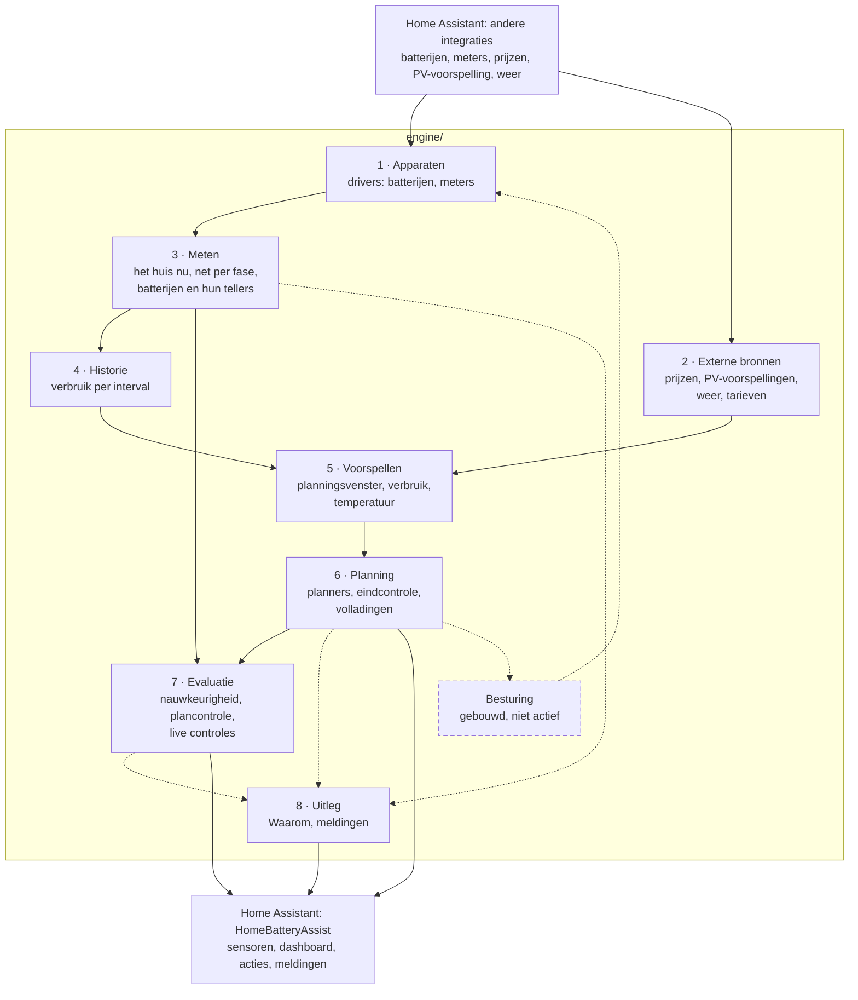
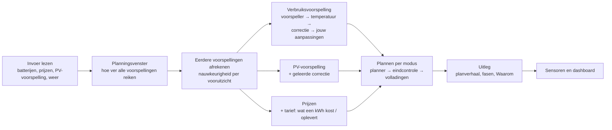
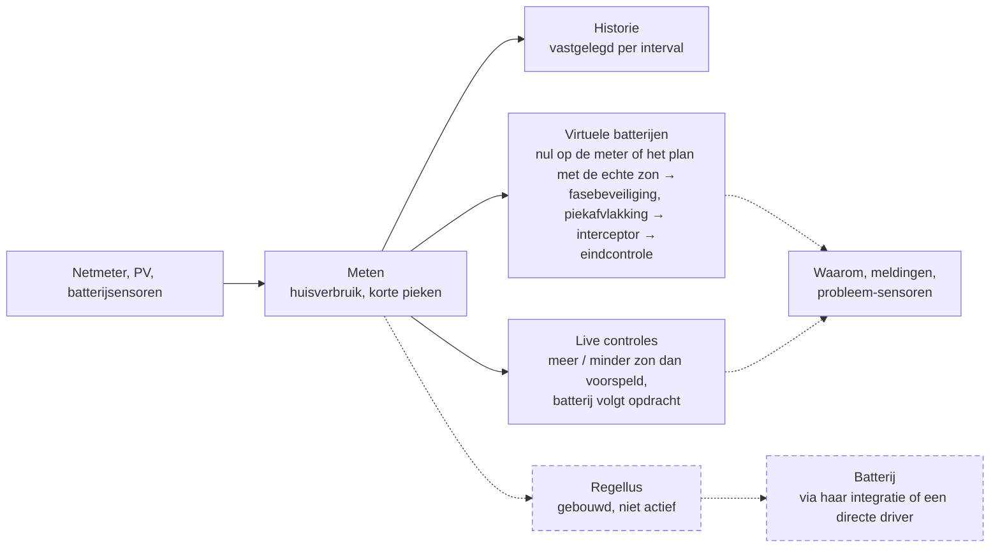

# Architectuur: lagen, drivers en modules {#architecture-layers-drivers-and-modules}

HomeBatteryAssist is in lagen opgebouwd. Gegevens stromen één kant op, van de apparaten naar de uitleg; een laag gebruikt alleen de lagen eronder.

| # | Laag | Wat ze doet | Map |
|---|---|---|---|
| 1 | **Apparaten** | Praat met de fysieke apparaten — voorlopig alleen lezen | `engine/devices/` |
| 2 | **Externe bronnen** | Prijzen, PV-voorspellingen, tarieven | `engine/sources/` |
| 3 | **Meten** | Het huis *nu*: verbruik, net per fase, batterijtoestanden en tellers | `engine/measure/` |
| 4 | **Historie** | Het verleden: verbruik per interval, import van oudere gegevens | `engine/history/` |
| 5 | **Voorspellen** | De toekomst: het planningsvenster en de verbruiksvoorspelling | `engine/forecast/` |
| 6 | **Planning** | Beslissen: planners, de eindcontrole, volladingen, fasegrenzen, meerdere batterijen | `engine/planning/` |
| 7 | **Evaluatie** | Achteraf: nauwkeurigheid van voorspellingen, plan tegenover wat er gebeurde | `engine/evaluation/` |
| 8 | **Uitleg** | De *Waarom*-teksten en meldingen | `engine/explain/` |
| – | **Home Assistant** | Entiteiten, dashboard, instellingen, acties | pakketroot (`output/`, `frontend/`, `config_flow.py`, …) |

`engine/coordinator.py` doorloopt de lagen in één cyclus (standaard elke 15 minuten, en wanneer er nieuwe prijzen binnenkomen).

## In één oogopslag {#at-a-glance}

Hoe de lagen samenhangen: gegevens komen bovenaan binnen en stromen naar beneden. Gestippelde pijlen: berichten voor *Waarom*, en de besturing die gebouwd is maar nog niet actief (gestreept vak).



### Eén voorspelcyclus {#one-forecast-cycle}

Wat `engine/coordinator.py` elke 15 minuten doet, en wanneer er nieuwe prijzen binnenkomen:



### Live, om de paar seconden {#live-every-few-seconds}

Wat er tussen twee cycli gebeurt, bij elke nieuwe meting:



## Drivers en modules {#drivers-and-modules}

- **Drivers** verbinden HomeBatteryAssist met *apparaten* (laag 1). Ze maken deel uit van de code; een nieuwe voeg je toe via een pull request. → [Drivers](drivers.md)
- **Modules** zijn de verwisselbare onderdelen van de *andere* lagen. De ingebouwde staan in hun laag; gevorderde gebruikers kunnen eigen modules toevoegen in `/config/homebatteryassist/<kind>/` en die in de instellingen kiezen, terwijl HomeBatteryAssist het laatste woord houdt. → [Modules](modules.md)

Elk uitbreidingspunt heeft dezelfde vorm: `base.py` (de interface), `template.py` (een voorbeeld, nooit aangeboden) en één bestand per ingebouwde variant.

## Mappenoverzicht {#folder-map}

```
custom_components/homebatteryassist/
├── __init__.py, config_flow.py, services.py, diagnostics.py, sensor.py, button.py
├── output/            entities and the dashboard's data
├── frontend/          the dashboard (panel.js)
├── strings.json, translations/
└── engine/
    ├── coordinator.py     one cycle through the layers
    ├── control/           battery_controller.py — built, not active;
    │                      control_loop.py — written out as comment;
    │                      interceptors/ (base.py, template.py, pass_through.py)
    ├── units.py           unit conversion
    ├── own_modules.py     loading own modules from /config
    ├── devices/           1  drivers
    │   ├── batteries/     base.py, template.py, virtual.py (simulation), recognition.py,
    │   │                  integrations/ (entity_reader.py, omnibattery_integration.py,
    │   │                  marstek_modbus_integration.py),
    │   │                  direct/ (base.py, modbus_driver.py, http_driver.py, mqtt_driver.py
    │   │                  — chosen per battery, direct/link.py),
    │   │                  one folder per brand: models (brand → range → type) + direct driver:
    │   │                  marstek/, anker/, huawei/, zendure/, sessy/, indevolt/, hoymiles/
    │   ├── transports/    modbus_tcp.py (own small Modbus TCP client)
    │   └── meters/        base.py, template.py, homewizard.py, sma.py, shelly.py,
    │                      iammeter.py, direct_reading.py, discovery.py,
    │                      via_ha_integration.py
    ├── sources/           2  modules
    │   ├── prices/        base.py, template.py, price_points.py, dyntarnl.py,
    │   │                  ha_price_actions.py, sensor_attributes.py, regional.py,
    │   │                  price_forecasts.py, in_development/ (tibber.py)
    │   ├── pv_forecasts/  base.py, template.py, solar_forecast_integrations.py,
    │   │                  energy_dashboard_platform.py
    │   ├── tariffs/       base.py, template.py, as_price_source.py
    │   └── weather/       base.py, template.py, ha_weather_entity.py, knmi_integration.py,
    │                      weerlive_api.py, open_meteo.py (optional)
    ├── measure/           3  house_measurement.py, battery_monitor.py, heating_zones.py,
    │                         spike_filters/ (base.py, template.py, short_peaks.py)
    ├── history/           4  consumption_history.py, history_import.py, chart_series.py,
    │                         temperature_import.py, spikes.py
    ├── forecast/          5  planning_window.py, consumption_forecast.py,
    │                         user_adjustments.py, phase_shares.py, temperature_effect.py,
    │                         forecasters/ (base.py, template.py, weekday_hour_profile.py,
    │                                       same_time_last_weeks.py)
    ├── planning/          6  battery_plan.py (final check), full_charge.py, phase_limit.py,
    │                         battery_distribution.py, time_slots.py,
    │                         planners/ (base.py, template.py, zero_on_meter.py, arbitrage.py)
    ├── evaluation/        7  forecast_accuracy.py, plan_check.py, unexpected_surplus.py,
    │                         pv_corrections/ (base.py, template.py, hour_and_level.py, lead_time.py)
    └── explain/           8  messages.py, plan_story.py, decision_log.py, notifications.py
```

## Batterijen: model en lezer {#batteries-model-and-reader}

Een batterijdriver bestaat uit twee delen:

- een **model** — wat de batterij *is* — geordend via overerving als **merk → typereeks → type**: `marstek/__init__.py` (Marstek) → `marstek/venus.py` (Venus) → `marstek/venus_e_v3.py` (Venus E v3). Een type erft van zijn reeks en merk en legt alleen zijn eigen specificaties vast (capaciteit, vermogen, bruikbaar deel, nominale cycli, garantie);
- een **lezer** — hoe de batterij *gelezen* wordt — één per integratie die batterijen beschikbaar stelt (`integrations/omnibattery_integration.py`, `integrations/marstek_modbus_integration.py`).

Eén batterijtype kan dus via meerdere integraties gelezen worden. De **virtuele batterij** (`virtual.py`) is een gesimuleerd apparaat dat het plan volgt.

## Regellaag (gebouwd, niet actief) {#control-layer-built-not-active}

In deze fase van de ontwikkeling stuurt HomeBatteryAssist nog geen batterijen aan. De regellaag (`engine/control/battery_controller.py`) is vooraf gebouwd, zodat de beveiliging op orde is voordat er iets aangestuurd wordt:

- een **hoofdschakelaar**, standaard uit — zolang die uit staat wordt er niets verstuurd, en niets in HomeBatteryAssist zet hem aan;
- **altijd vrijgeven**: de regie gaat terug naar de eigen logica van de batterij bij stoppen, herladen, herstarten en elke fout;
- een **watchdog**: komt er 2 minuten geen nieuw commando, dan wordt de regie vrijgegeven;
- **verversen** van het laatste commando voor batterijen die anders uit externe aansturing vallen;
- **afremmen**: minstens 5 s tussen commando's voor elke batterij (een driver kan om langer vragen) en een dode band (naar rust gaan wordt nooit tegengehouden; richtingwisselingen worden ook afgeremd); een ongeldig vermogen (NaN) geeft vrij; een mislukte vrijgave wordt elke tik opnieuw geprobeerd tot die lukt;
- **rust = vrijgeven** voor batterijen waarbij 0 W geen rust is (bijv. een Huawei-omvormer blijft dan PV begrenzen);
- de **grenzen** van het apparaat en van de aanroeper worden altijd afgedwongen.

Een test (`tests/test_read_only.py`) faalt zodra code buiten de drivers en deze laag een schrijfmethode aanroept, een controller aanmaakt, een directe driver inschakelt of een Home Assistant-actie aanroept die een apparaat verandert.

Elke [directe driver](drivers.md#direct-battery-drivers) geeft zijn eigen eisen voor aansturing aan; de controller dwingt die af.

De **regellus** (`engine/control/control_loop.py`) draait alleen met de instelling *Besturing aan* (onderdeel *Besturing*, standaard uit), en alleen voor batterijen met *Aangestuurd door HomeBatteryAssist* in hun formulier (standaard uit). Het is de simulator van de virtuele batterijen op de aangestuurde echte batterijen, dus hij heeft elke ronde dezelfde doelen (standaard 5 s, direct bij een grote sprong of overbelasting): nul op de meter (nooit voor uitgesloten apparaten of willekeurige korte pieken) of het plan (instelling *Besturingsmodus*: *Nul op de meter* wat het plan ook zegt, of *Volgens het plan*), volle ladingen, verdeeld over de batterijen, fasebeveiliging en peak shaving, de interceptor, grenzen voor het laadniveau en het systeem. Hij werkt op het gemeten net zonder de aangestuurde batterijen, en geeft elke batterij haar vermogen via haar controller, over haar directe verbinding of anders haar integratie. Een batterij gaat terug naar haar eigen sturing zolang er een test op loopt, ze haar opdracht niet volgt, haar laadniveau of vermogen onbekend is of de netmeting weg is, en bij stoppen; *Waarom* meldt elke wissel.

**Testbesturing (gebouwd, uitgeschakeld).** Elke echte batterij heeft *Test: laden*, *Test: ontladen* en *Test: stoppen* (knoppen), een *Testvermogen* en een *Testduur* (getallen) en een status *Testbesturing*, om het aansturen van een batterij met de hand te testen vóór elke automatische besturing (`engine/control/control_test.py`, via `reader_driver.py`: `LinkDriver` over de directe verbinding van de batterij, anders `ReaderDriver` via haar integratie). Een test laadt of ontlaadt met het testvermogen gedurende de testduur en geeft de batterij daarna altijd terug aan haar eigen sturing; hij stopt meteen als de batterij vol is of op haar laagst toegestane laadniveau zit, de opdracht niet volgt, bij een fout, met *Test: stoppen* en bij herladen. Hij staat uit tenzij de instelling *Testbesturing aan* aan staat (standaard `CONTROL_TEST_ALLOWED = False`, bewaakt door een test): een knop meldt dat alleen in *Waarom*, er wordt niets verstuurd.

## Meters {#meters}

Eén bestand per merk (`homewizard.py`, `sma.py`, `shelly.py`, `iammeter.py`), die samen `direct_reading.py` gebruiken (ongeveer eens per seconde lezen, een waarde die verouderd raakt). Meters kunnen ook via hun eigen Home Assistant-integratie gelezen worden (`via_ha_integration.py`).
