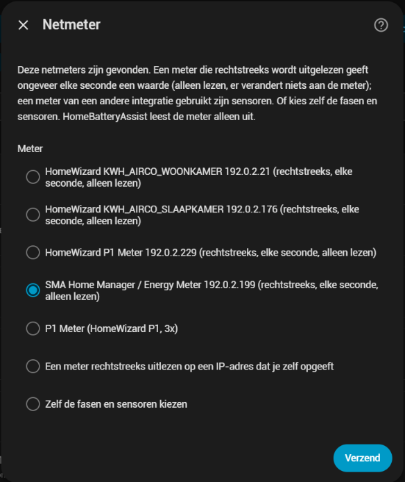
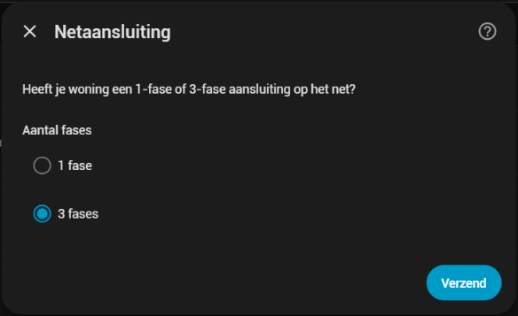
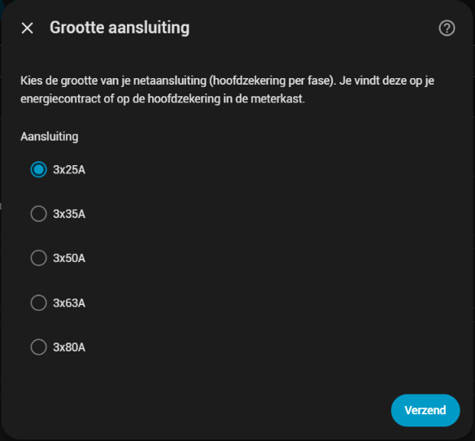
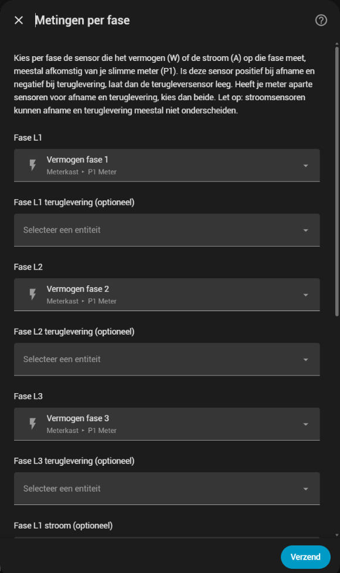
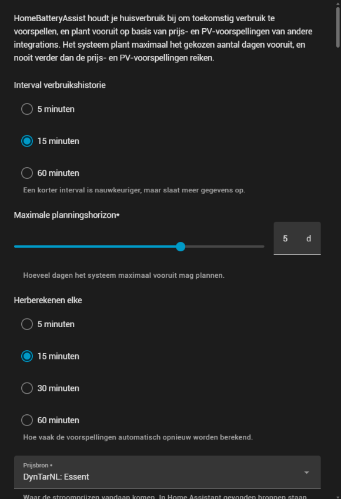
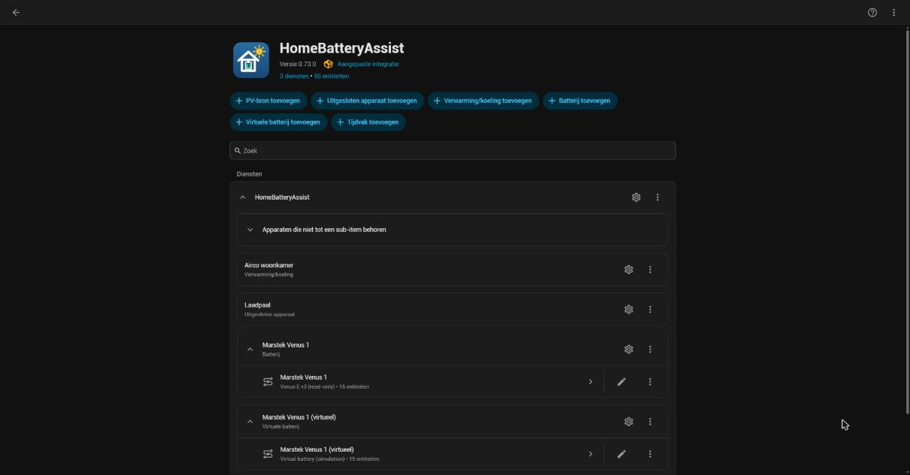

# Getting started

This page takes you through the installation and setup **step by step**. Count on about 15 minutes. You can change everything later, so do not worry about getting every setting right the first time.

## Before you start {#before-you-start}

You need:

- [x] **Home Assistant 2025.6 or newer**, with **HACS** installed.
- [x] **A measurement of your grid connection** per phase. One of:
    - a meter HomeBatteryAssist reads directly: **HomeWizard P1** (local API on), **SMA Home Manager / Energy Meter**, **Shelly Pro 3EM / EM** or **Iammeter**;
    - or sensors per phase from any integration (e.g. your smart meter / P1 integration), in W (or A).

Useful, but optional (you can add them later):

- [ ] **Your battery's own integration**, e.g. **Omnibattery** or **Marstek Modbus**. HomeBatteryAssist only reads the battery; that integration keeps controlling it. No battery yet? Add a *virtual battery* to see what one would bring.
- [ ] **A price integration with dynamic prices**, e.g. **DynTarNL** (recommended in the Netherlands), Nord Pool, EnergyZero or easyEnergy. Needed for arbitrage and for the costs.
- [ ] **A solar forecast** in the Energy dashboard (e.g. Solcast or Forecast.Solar), if you have solar panels.
- [ ] **A weather source** (a weather entity, the KNMI integration, Weerlive or Open-Meteo), if you heat or cool electrically.

## Step 1 — Install with HACS {#step-1-install-with-hacs}

1. Open **HACS**, the menu (⋮) at the top right → **Custom repositories**.
2. Add `https://github.com/mvanrijnen/HomeBatteryAssist`, type **Integration**.
3. Search for **HomeBatteryAssist**, open it and choose **Download**.
4. **Restart Home Assistant** (Settings → System → Restart).

??? note "Without HACS"
    Copy the folder `custom_components/homebatteryassist` from the repository into `config/custom_components/` of your Home Assistant and restart.

## Step 2 — Add the integration {#step-2-add-the-integration}

Go to **Settings → Devices & services → + Add integration** and search for **HomeBatteryAssist**. The setup asks a few questions about your grid connection.

## Step 3 — Choose your grid meter {#step-3-choose-your-grid-meter}

HomeBatteryAssist lists the meters it found on your network and in other integrations.

{ width="420" }

- **A meter read directly** (e.g. *SMA Home Manager … (directly, every second, read-only)*): the best choice — a value about every second, and nothing on the meter changes. Phases and sensors are filled in for you.
- **A meter of another integration** (e.g. *P1 Meter (HomeWizard P1, 3x)*): its sensors are used.
- **Read a meter directly at an IP address you enter**: when your meter was not found (pick the type and enter its address).
- **Choose the phases and sensors yourself**: for any other measurement.

## Step 4 — Phases, connection size and sensors {#step-4-phases-connection-size-and-sensors}

Depending on your choice you get (some of) these screens:

=== "Phases"

    { width="420" }

    1 phase or 3 phases — see your meter cupboard or energy contract.

=== "Connection size"

    { width="420" }

    The main fuse per phase, e.g. **3x25A**. HomeBatteryAssist keeps every phase below it (with a safety margin).

=== "Sensors per phase"

    { width="420" }

    The power (W) per phase, positive for import and negative for export. Has your meter separate sensors for import and export? Fill in both. Current (A) and voltage (V) per phase are optional, but make the phase protection more precise.

## Step 5 — The settings {#step-5-the-settings}

The last setup screen holds the settings. The defaults are a good start; check these:

{ width="420" }

| Setting | Advice |
|---|---|
| **Price source** | Your price integration (e.g. *DynTarNL*). Without prices you can still use zero on the meter. |
| **Battery plan mode** | Start with **Zero on the meter** (the battery covers your own use) or **Arbitrage** (also charges from the grid when that is cheaper later). All modes are always calculated, so you can compare them on the dashboard. |
| **PV forecast** | Tick your solar forecast if you have solar panels. |
| **Maximum planning horizon** | 2 days is fine; more when your price source gives a longer forecast. |

The collapsible sections below (export price, limits and reserve, short peaks, weather, …) can stay as they are for now. Every field is explained on the screen and in the [Settings reference](reference.md).

Choose **Submit**. HomeBatteryAssist is now running, and **HomeBatteryAssist** appears in the sidebar.

## Step 6 — Add your devices {#step-6-add-your-devices}

On the integration page you add the parts of your home with the **+** buttons. Each can be changed later with its gear icon.

{ width="700" }

1. **+ Add battery** — pick your battery from the list (Omnibattery and Marstek Modbus batteries are recognised and filled in), or link one by its sensors. Check the capacity, the minimum state of charge and **the phase** it is connected to.
2. **+ Add PV source** — the power of your solar inverter(s), so the house consumption is right.
3. **+ Add excluded device** — big loads you do not want in the consumption forecast and the battery should not supply, such as an **EV charger**.
4. **+ Add heating/cooling** *(optional)* — a heat pump or air conditioner; with a room temperature sensor the forecast learns how it follows the weather.
5. **+ Add virtual battery** *(optional)* — a simulated battery that follows the plan live: see what a (bigger) battery would do and bring.
6. **+ Add time slot** *(optional)* — only for the plan mode *Time slots*.

!!! tip "Which phase?"
    On 3 phases, set the phase of each battery and device correctly. HomeBatteryAssist uses it to keep every phase below the main fuse.

## Step 7 — Import your history {#step-7-import-your-history}

The consumption forecast learns from your history. Fill it at once from Home Assistant's statistics, so the forecasts are good from day one:

1. Go to **Developer tools → Actions**.
2. Choose **HomeBatteryAssist: Import consumption history**.
3. Set **Days** to **28** and choose **Perform action**.

```yaml
action: homebatteryassist.import_history
data:
  days: 28
```

Without importing, HomeBatteryAssist simply starts learning from now.

## Step 8 — Open the dashboard {#step-8-open-the-dashboard}

Open **HomeBatteryAssist** in the sidebar.

- **Overview** — the energy flows now and today, the grid connection per phase, and **Why**: every decision in plain language.
- **Forecast** — expected consumption, solar power and prices, with the battery plan as coloured bands.
- **Return** — what each plan mode would bring compared with no battery.
- **Batteries** — your batteries in detail.
- **Accuracy** — how good each forecast turned out to be.

See [Dashboard](dashboard.md) and the [Screenshots](screenshots.md).

## Step 9 — The first days {#step-9-the-first-days}

- **Day 1**: forecasts and plans are there at once (with imported history). Read *Why* to see what the plan intends.
- **First week**: HomeBatteryAssist compares every forecast with what really happened and starts correcting forecasts that are consistently off. The *Accuracy* tab shows how it goes.
- **After about a week**: with heating/cooling and a weather source, the temperature effect is learned.

## Checklist {#checklist}

- [ ] The grid power on *Overview* matches your meter.
- [ ] The house consumption looks plausible (it is never negative; check the PV source and the battery's power direction if it looks odd).
- [ ] Your battery shows the right state of charge and power on *Batteries*.
- [ ] *Forecast* shows prices and (with solar panels) a solar forecast.
- [ ] *Why* explains the plan.

Something not right? See the [FAQ](faq.md).

## Next steps {#next-steps}

- Fine-tune reserves, peak shaving and limits: [Planning](planning.md) and [Settings reference](reference.md).
- Get notifications or use the sensors in automations: [Working with other integrations](integration.md).
- Write your own planner or forecaster: [Modules](modules.md).
