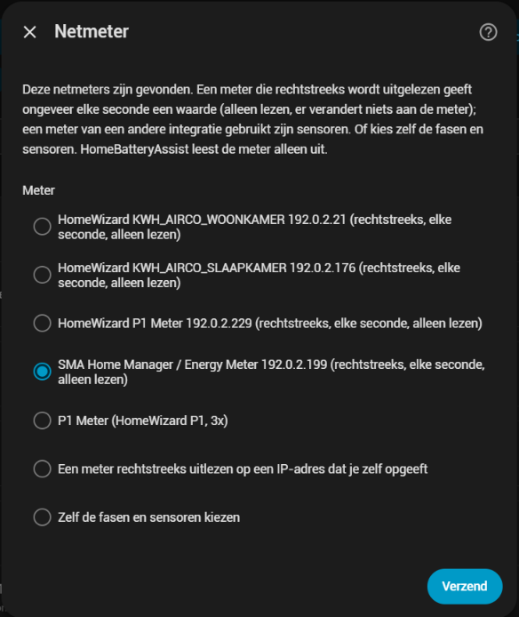
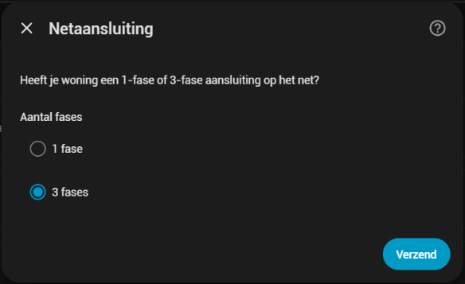
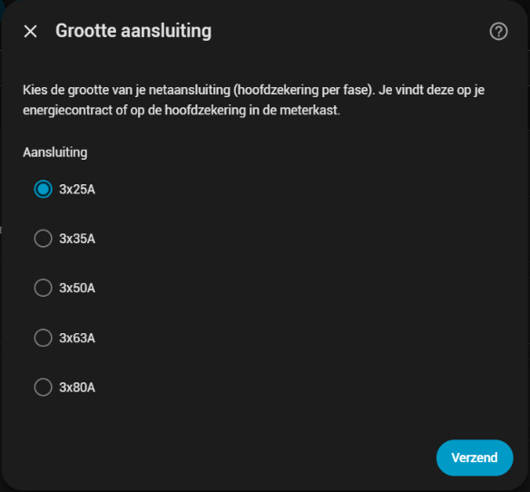
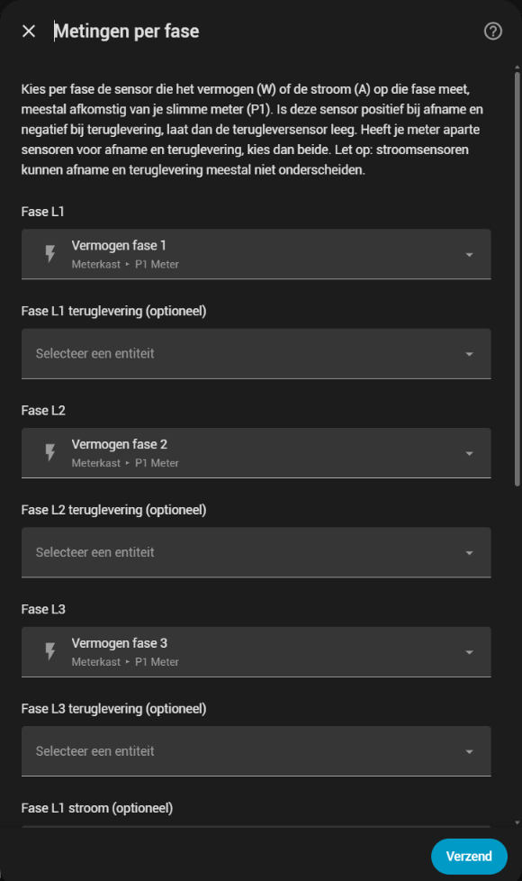
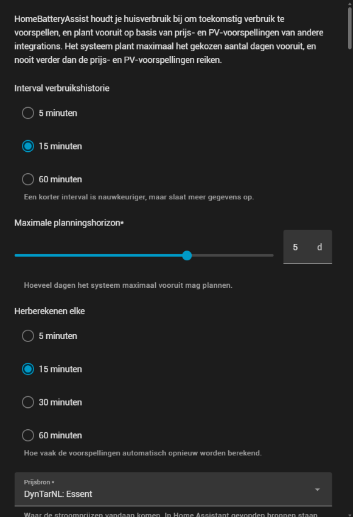
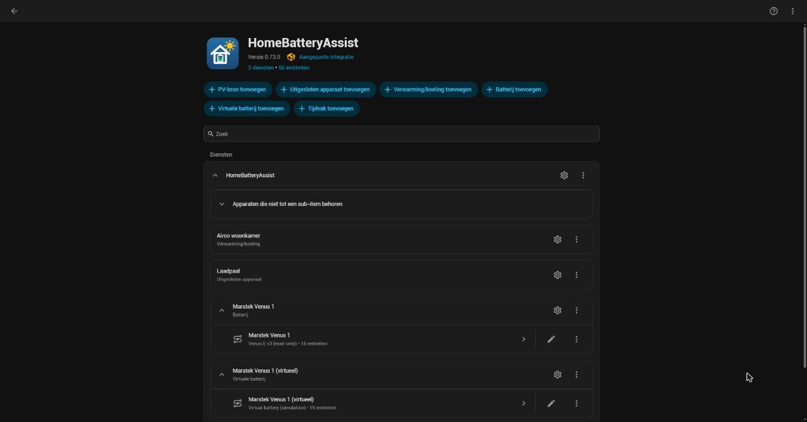

# Aan de slag

Deze pagina neemt je **stap voor stap** mee door de installatie en het instellen. Reken op ongeveer een kwartier. Alles is later nog te wijzigen, dus maak je niet druk als niet elke instelling meteen goed staat.

## Voordat je begint {#before-you-start}

Je hebt nodig:

- [x] **Home Assistant 2025.6 of nieuwer**, met **HACS** geïnstalleerd.
- [x] **Een meting van je netaansluiting** per fase. Een van deze:
    - een meter die HomeBatteryAssist rechtstreeks uitleest: **HomeWizard P1** (lokale API aan), **SMA Home Manager / Energy Meter**, **Shelly Pro 3EM / EM** of **Iammeter**;
    - of sensoren per fase van een andere integratie (bijv. je slimme meter / P1-integratie), in W (of A).

Handig, maar niet verplicht (kun je later toevoegen):

- [ ] **De eigen integratie van je batterij**, bijv. **Omnibattery** of **Marstek Modbus**. HomeBatteryAssist leest de batterij alleen uit; die integratie blijft hem aansturen. Nog geen batterij? Voeg een *virtuele batterij* toe om te zien wat er een zou opleveren.
- [ ] **Een prijsintegratie met dynamische prijzen**, bijv. **DynTarNL** (aanbevolen in Nederland), Nord Pool, EnergyZero of easyEnergy. Nodig voor arbitrage en voor de kosten.
- [ ] **Een zonvoorspelling** in het Energie-dashboard (bijv. Solcast of Forecast.Solar), als je zonnepanelen hebt.
- [ ] **Een weerbron** (een weer-entiteit, de KNMI-integratie, Weerlive of Open-Meteo), als je elektrisch verwarmt of koelt.

## Stap 1 — Installeren met HACS {#step-1-install-with-hacs}

1. Open **HACS**, het menu (⋮) rechtsboven → **Aangepaste repositories**.
2. Voeg `https://github.com/mvanrijnen/HomeBatteryAssist` toe, type **Integratie**.
3. Zoek **HomeBatteryAssist**, open het en kies **Downloaden**.
4. **Herstart Home Assistant** (Instellingen → Systeem → Herstarten).

??? note "Zonder HACS"
    Kopieer de map `custom_components/homebatteryassist` uit de repository naar `config/custom_components/` van je Home Assistant en herstart.

## Stap 2 — De integratie toevoegen {#step-2-add-the-integration}

Ga naar **Instellingen → Apparaten & diensten → + Integratie toevoegen** en zoek **HomeBatteryAssist**. Het instellen begint met een paar vragen over je netaansluiting.

## Stap 3 — Kies je netmeter {#step-3-choose-your-grid-meter}

HomeBatteryAssist toont de meters die het in je netwerk en in andere integraties heeft gevonden.

{ width="420" }

- **Een meter die rechtstreeks wordt uitgelezen** (bijv. *SMA Home Manager … (rechtstreeks, elke seconde, alleen lezen)*): de beste keuze — ongeveer elke seconde een waarde, en er verandert niets aan de meter. Fasen en sensoren worden voor je ingevuld.
- **Een meter van een andere integratie** (bijv. *P1 Meter (HomeWizard P1, 3x)*): zijn sensoren worden gebruikt.
- **Een meter rechtstreeks uitlezen op een IP-adres dat je zelf opgeeft**: als je meter niet gevonden is (kies het type en vul het adres in).
- **Zelf de fasen en sensoren kiezen**: voor elke andere meting.

## Stap 4 — Fasen, aansluiting en sensoren {#step-4-phases-connection-size-and-sensors}

Afhankelijk van je keuze krijg je (een deel van) deze schermen:

=== "Fasen"

    { width="420" }

    1 fase of 3 fasen — zie je meterkast of energiecontract.

=== "Grootte aansluiting"

    { width="420" }

    De hoofdzekering per fase, bijv. **3x25A**. HomeBatteryAssist houdt elke fase daaronder (met een veiligheidsmarge).

=== "Metingen per fase"

    { width="420" }

    Het vermogen (W) per fase, positief bij afname en negatief bij teruglevering. Heeft je meter aparte sensoren voor afname en teruglevering? Vul dan beide in. Stroom (A) en spanning (V) per fase zijn optioneel, maar maken de fasebeveiliging preciezer.

## Stap 5 — De instellingen {#step-5-the-settings}

Het laatste scherm bevat de instellingen. De standaardwaarden zijn een goed begin; kijk vooral naar deze:

{ width="420" }

| Instelling | Advies |
|---|---|
| **Prijsbron** | Je prijsintegratie (bijv. *DynTarNL*). Zonder prijzen kun je nul op de meter gewoon gebruiken. |
| **Modus batterijplan** | Begin met **Nul op de meter (NOM)** (de batterij dekt je eigen verbruik) of **Arbitrage (kostenoptimaal)** (laadt ook uit het net als dat later goedkoper uitkomt). Alle modi worden altijd doorgerekend, dus je kunt ze op het dashboard vergelijken. |
| **PV-voorspelling** | Vink je zonvoorspelling aan als je zonnepanelen hebt. |
| **Maximale planningshorizon** | 2 dagen is prima; meer als je prijsbron verder vooruit voorspelt. |

De uitklapbare secties daaronder (terugleverprijs, grenzen en reserve, korte pieken, weer, …) kunnen voorlopig blijven zoals ze zijn. Elk veld wordt op het scherm uitgelegd en staat in [Instellingen](reference.md).

Kies **Verzenden**. HomeBatteryAssist draait nu, en **HomeBatteryAssist** verschijnt in de zijbalk.

## Stap 6 — Voeg je apparaten toe {#step-6-add-your-devices}

Op de integratiepagina voeg je de onderdelen van je huis toe met de **+**-knoppen. Elk onderdeel kun je later wijzigen met het tandwiel ernaast.

{ width="700" }

1. **+ Batterij toevoegen** — kies je batterij uit de lijst (batterijen van Omnibattery en Marstek Modbus worden herkend en ingevuld), of koppel er een via zijn sensoren. Controleer de capaciteit, de minimale vulling en **de fase** waarop hij is aangesloten.
2. **+ PV-bron toevoegen** — het vermogen van je omvormer(s), zodat het huisverbruik klopt.
3. **+ Uitgesloten apparaat toevoegen** — grote verbruikers die je niet in de verbruiksvoorspelling wilt en waarvoor de batterij niet moet ontladen, zoals een **laadpaal**.
4. **+ Verwarming/koeling toevoegen** *(optioneel)* — een warmtepomp of airco; met een sensor voor de kamertemperatuur leert de voorspelling hoe die het weer volgt.
5. **+ Virtuele batterij toevoegen** *(optioneel)* — een gesimuleerde batterij die het plan live volgt: zie wat een (grotere) batterij zou doen en opleveren.
6. **+ Tijdvak toevoegen** *(optioneel)* — alleen voor de planmodus *Tijdvakken*.

!!! tip "Welke fase?"
    Bij 3 fasen: zet de fase van elke batterij en elk apparaat goed. HomeBatteryAssist gebruikt die om elke fase onder de hoofdzekering te houden.

## Stap 7 — Importeer je historie {#step-7-import-your-history}

De verbruiksvoorspelling leert van je historie. Vul die meteen uit de statistieken van Home Assistant, zodat de voorspellingen vanaf dag één goed zijn:

1. Ga naar **Ontwikkelhulpmiddelen → Acties**.
2. Kies **HomeBatteryAssist: Verbruikshistorie importeren**.
3. Zet **Dagen** op **28** en kies **Actie uitvoeren**.

```yaml
action: homebatteryassist.import_history
data:
  days: 28
```

Importeer je niets, dan begint HomeBatteryAssist gewoon vanaf nu te leren.

## Stap 8 — Open het dashboard {#step-8-open-the-dashboard}

Open **HomeBatteryAssist** in de zijbalk.

- **Overzicht** — de energiestromen nu en vandaag, de netaansluiting per fase, en **Waarom**: elke beslissing in gewone taal.
- **Voorspelling** — verwacht verbruik, zonnestroom en prijzen, met het batterijplan als gekleurde banden.
- **Rendement** — wat elke planmodus zou opleveren ten opzichte van geen batterij.
- **Batterijen** — je batterijen in detail.
- **Nauwkeurigheid** — hoe goed elke voorspelling uitkwam.

Zie [Dashboard](dashboard.md) en de [Screenshots](screenshots.md).

## Stap 9 — De eerste dagen {#step-9-the-first-days}

- **Dag 1**: voorspellingen en plannen zijn er meteen (met geïmporteerde historie). Lees *Waarom* om te zien wat het plan van plan is.
- **Eerste week**: HomeBatteryAssist vergelijkt elke voorspelling met wat er echt gebeurde en gaat voorspellingen bijstellen die steeds afwijken. Het tabblad *Nauwkeurigheid* laat zien hoe dat gaat.
- **Na ongeveer een week**: met verwarming/koeling en een weerbron is het effect van de temperatuur geleerd.

## Controlelijst {#checklist}

- [ ] Het netvermogen op *Overzicht* klopt met je meter.
- [ ] Het huisverbruik ziet er logisch uit (het is nooit negatief; kijk bij iets vreemds naar de PV-bron en de richting van het batterijvermogen).
- [ ] Je batterij toont op *Batterijen* het juiste laadniveau en vermogen.
- [ ] *Voorspelling* toont prijzen en (met zonnepanelen) een zonvoorspelling.
- [ ] *Waarom* legt het plan uit.

Klopt er iets niet? Zie de [veelgestelde vragen](faq.md).

## Volgende stappen {#next-steps}

- Reserves, piekafvlakking en grenzen bijstellen: [Planning](planning.md) en [Instellingen](reference.md).
- Meldingen krijgen of de sensoren gebruiken in automatiseringen: [Werken met andere integraties](integration.md).
- Een eigen planner of voorspeller schrijven: [Modules](modules.md).
