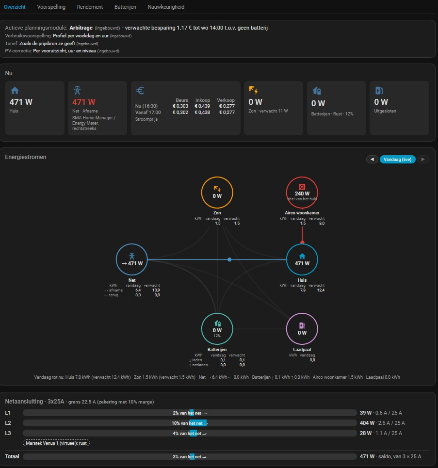

# HomeBatteryAssist

**Inzicht, voorspellingen en plannen voor je thuisbatterijen — in Home Assistant, uitgelegd in gewone taal.**

HomeBatteryAssist meet de energiestromen in je huis, voorspelt verbruik, prijzen en zonnestroom, en rekent uit wat je batterijen het beste kunnen doen: wanneer laden, met zon of uit het net, en wanneer het huis van stroom voorzien. Elke voorspelling wordt achteraf vergeleken met wat er echt gebeurde, en elk plan wordt in gewone woorden uitgelegd.

!!! warning "Alfa — volop in ontwikkeling"
    Instellingen, entiteiten en gedrag kunnen nog veranderen, en releases zijn alpha-releases. **In deze fase leest, voorspelt en adviseert HomeBatteryAssist**; *virtuele batterijen* volgen de plannen als simulatie. Zelf een batterij aansturen kan, maar staat **standaard uit** en is nog niet breed getest: de instelling *Besturing aan* en een [testbesturing](measuring.md#test-control-switched-off-for-now) per batterij, over een [directe verbinding](drivers.md#direct-battery-drivers). Zet een andere integratie die de batterij aanstuurt eerst uit.

[Aan de slag :material-arrow-right:](getting-started.md){ .md-button .md-button--primary } [Screenshots](screenshots.md){ .md-button } [GitHub](https://github.com/mvanrijnen/HomeBatteryAssist){ .md-button }

## Wat het doet {#what-it-does}

-   :material-flash: **Meet**

    ---

    De netaansluiting per fase (rechtstreeks uitgelezen van bijv. een HomeWizard P1 of SMA Home Manager, of uit je eigen sensoren), je batterijen, zonnestroom, een laadpaal en verwarming/koeling — en daaruit het echte huisverbruik.

    [:material-arrow-right: Meten](measuring.md)

-   :material-chart-line: **Voorspelt**

    ---

    Het huisverbruik uit je eigen historie (desgewenst met het weer erbij voor verwarming of koeling), met de prijzen en zonvoorspelling uit je integraties. Elke voorspelling wordt achteraf gecontroleerd en bijgesteld waar hij steeds afwijkt.

    [:material-arrow-right: Voorspellen](forecasting.md)

-   :material-battery-charging: **Plant**

    ---

    Wat de batterijen het beste kunnen doen — nul op de meter of arbitrage — binnen de grenzen van de batterijen en de hoofdzekering, met reserves, piekafvlakking en periodiek volladen. Elk plan wordt vergeleken met geen batterij.

    [:material-arrow-right: Planning](planning.md)

-   :material-message-text: **Legt uit**

    ---

    Elk plan en elke verandering in gewone taal: wat er gebeurt tot wanneer, en waarom — ook wat je echte batterij uit zichzelf doet.

    [:material-arrow-right: Planning: uitleg](planning.md#explanation)

-   :material-view-dashboard: **Laat zien**

    ---

    Een dashboard in de zijbalk met de energiestromen, voorspellingen, het rendement van elke planmodus, je batterijen en de nauwkeurigheid van elke voorspelling.

    [:material-arrow-right: Dashboard](dashboard.md)

-   :material-puzzle: **Is aan te passen**

    ---

    Planner, verbruiksvoorspeller, tarief, PV-correctie, piekfilter, weerbron en onderschepper zijn *modules*: kies een ingebouwde of voeg je eigen toe — HomeBatteryAssist houdt het laatste woord.

    [:material-arrow-right: Modules](modules.md)

## Werkt met {#works-with}

- **Netmeters**: HomeWizard P1 (rechtstreeks uitgelezen), SMA Home Manager / Energy Meter (Speedwire), Shelly Pro 3EM / EM, Iammeter, of willekeurige sensoren per fase.
- **Batterijen**: via de integratie die ze aanstuurt, bijv. **Omnibattery** of **Marstek Modbus** (automatisch herkend); elke andere batterij koppel je via zijn sensoren.
- **Prijzen**: DynTarNL (getest, inclusief terugleverprijs), Nord Pool, EnergyZero, easyEnergy en prijssensoren met een voorspelling.
- **Zonvoorspelling**: de voorspellingen uit het Energie-dashboard (bijv. Solcast, Forecast.Solar).
- **Weer** (optioneel): een weer-entiteit, de KNMI-integratie, Weerlive of Open-Meteo.

## Verder {#where-to-next}

- Nieuw? Volg **[Aan de slag](getting-started.md)** stap voor stap.
- Op zoek naar één instelling? Zie **[Instellingen](reference.md)**.
- Iets onverwachts? Kijk bij de **[veelgestelde vragen](faq.md)**.
- Automatiseringen of eigen modules maken? Zie **[Werken met andere integraties](integration.md)** en **[Modules](modules.md)**.
