# Screenshots

Every screen of HomeBatteryAssist (Dutch interface, dark theme), taken from a live installation (the overview per screen v0.106, the parts v0.73/v0.74). Each large screen has an overview and a picture per part; click a picture for full size. Private details (network addresses, serial numbers) are replaced by example values.

- **Dashboard**: [Overview](#overview) · [Forecast](#forecast) · [Return](#return) · [Batteries](#batteries) · [Accuracy](#accuracy)
- **Configuration**: [Integration page and menu](#integration-page-and-menu) · [Settings](#settings) · [Grid connection and meter (also the first setup steps)](#grid-connection-and-meter-also-the-first-setup-steps) · [Battery](#battery) · [Virtual battery](#virtual-battery) · [PV source](#pv-source) · [Excluded device](#excluded-device) · [Heating/cooling](#heatingcooling) · [Time slot](#time-slot)

## Dashboard

### Overview

**Active modules**

**Now**

**Energy flows**

**Grid connection**

[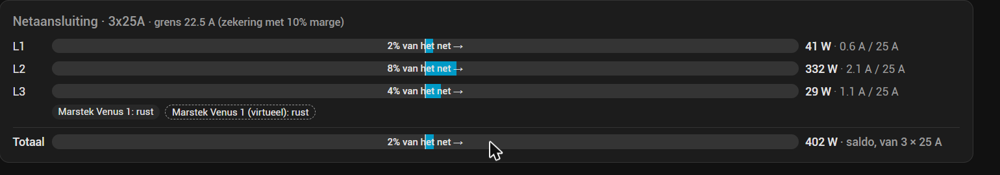](screenshots/overview-grid-connection.png)

**Why**

### Forecast

**Energy flows and expected consumption**

**Battery fill**

[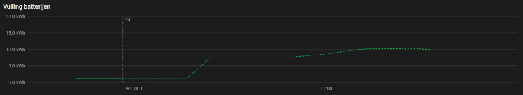](screenshots/forecast-battery-fill.png)

**Temperature and heating/cooling**

[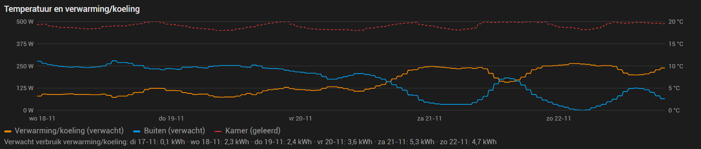](screenshots/forecast-temperature.png)

**Past 7 days and average day**

[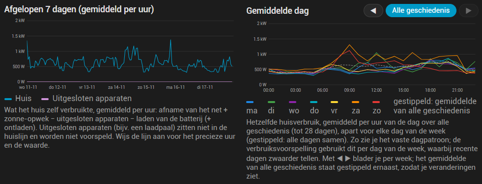](screenshots/forecast-history.png)

**Planning window**

**Planning window and Why (v0.106)**

[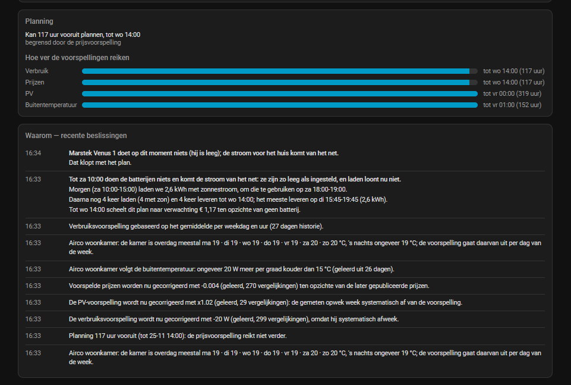](screenshots/forecast-planning-why.png)

### Return

[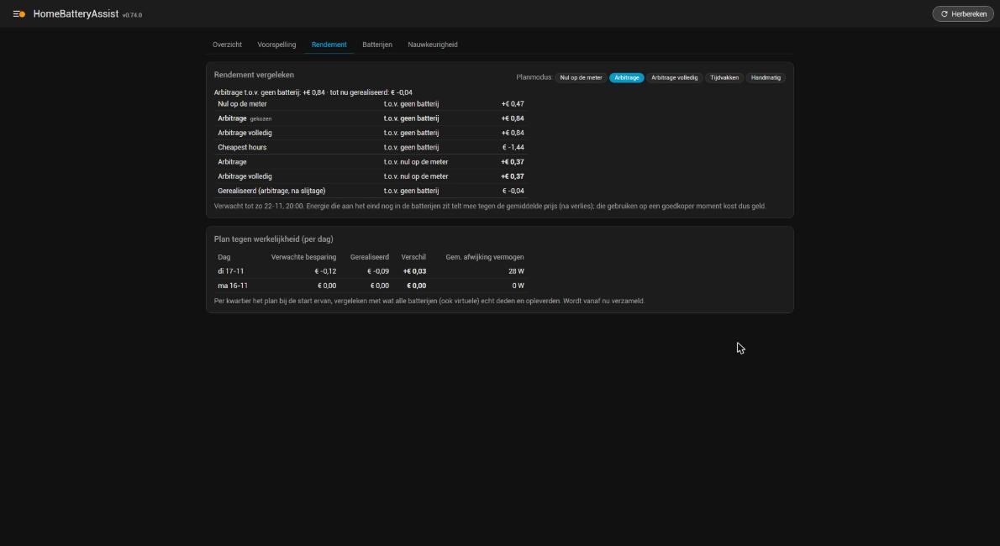](screenshots/return.jpg)

**Modes compared**

[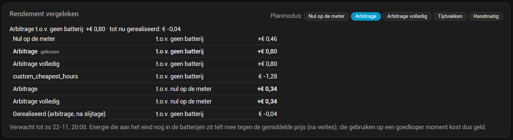](screenshots/return-compare.png)

**Plan against reality**

### Batteries

**Battery cards**

[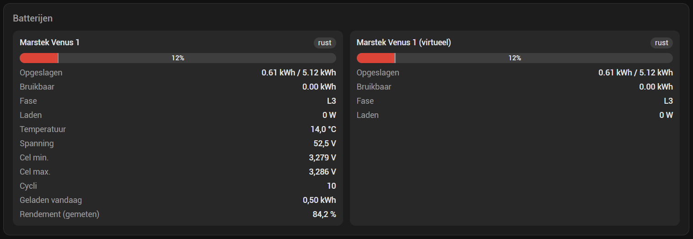](screenshots/batteries-cards.png)

### Accuracy

[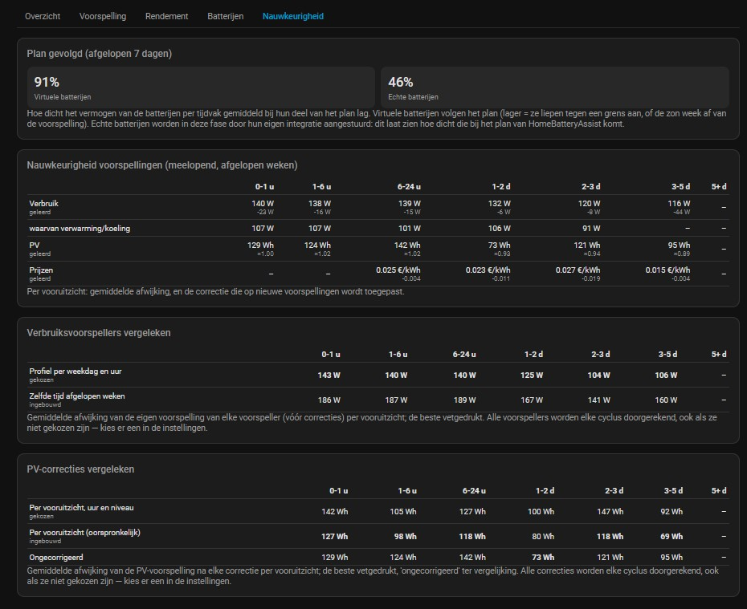](screenshots/accuracy.jpg)

**Forecast accuracy**

**Consumption forecasters**

**PV corrections**

## Configuration

### Integration page and menu

[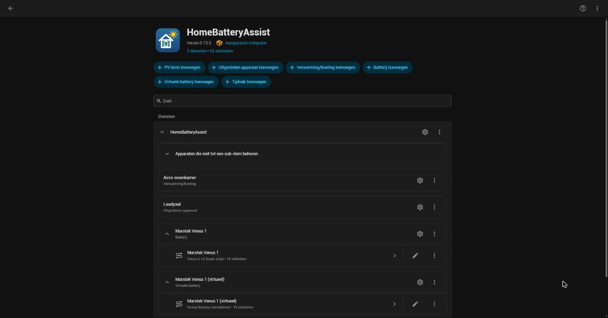](screenshots/config-integration.jpg)

### Settings

  

  

  [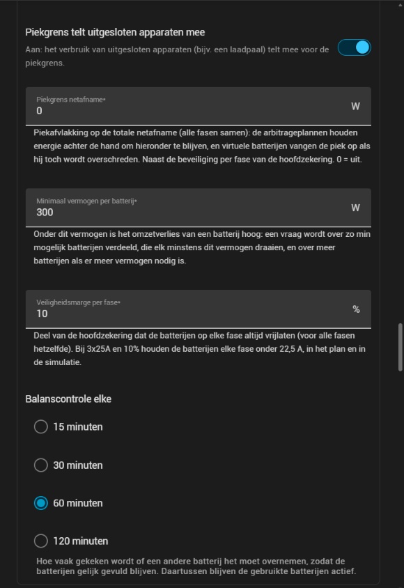](screenshots/config-settings-limits-2.png)

[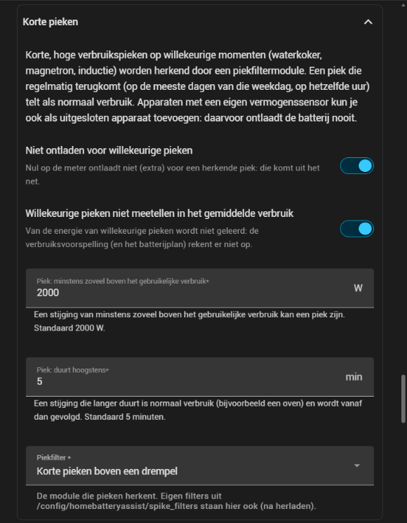](screenshots/config-settings-spikes.png)  

[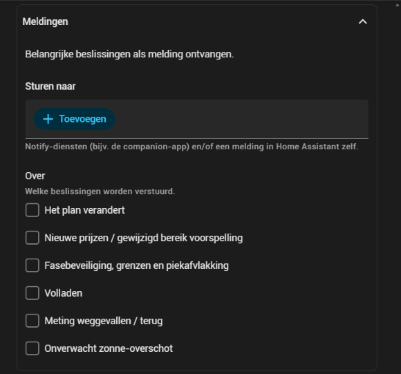](screenshots/config-settings-notifications.png)  

### Grid connection and meter (also the first setup steps)

 [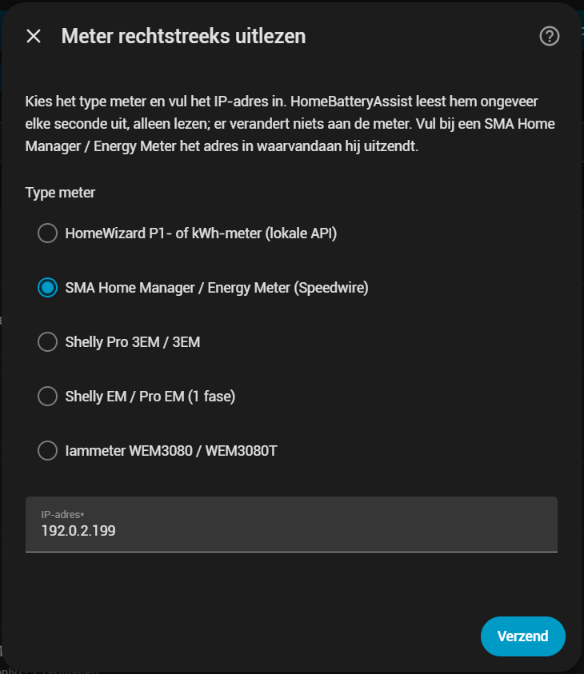](screenshots/config-grid-direct-meter.png) 

  

### Battery

  [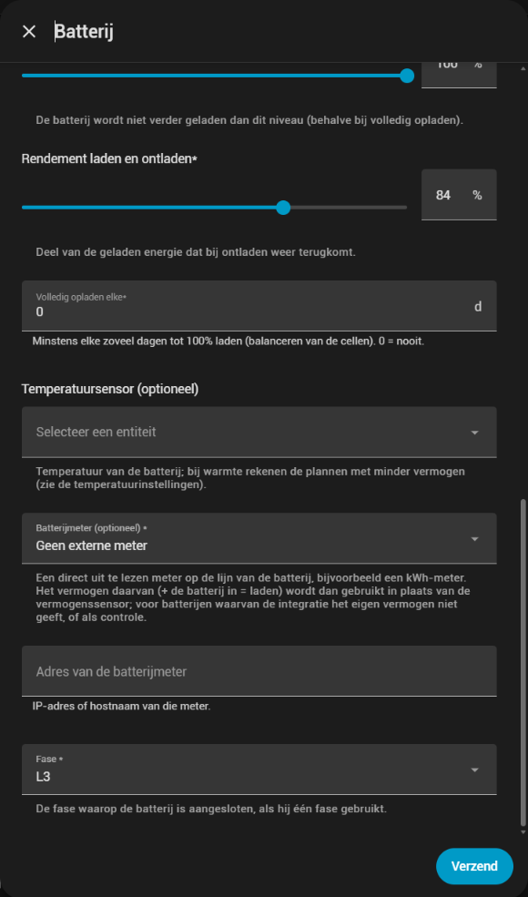](screenshots/config-battery-3.png)

### Virtual battery

 

### PV source

[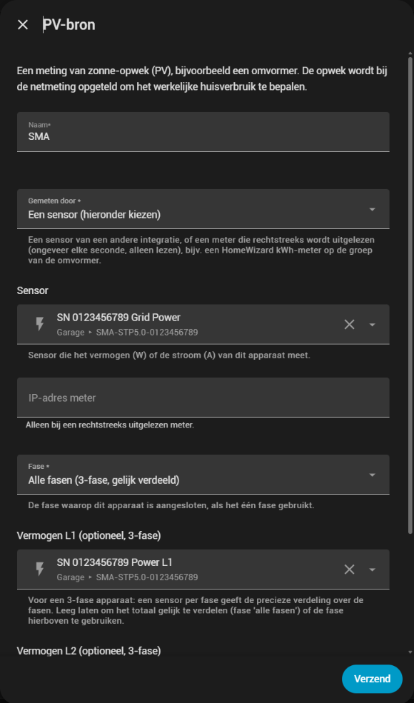](screenshots/config-pv-source-1.png) [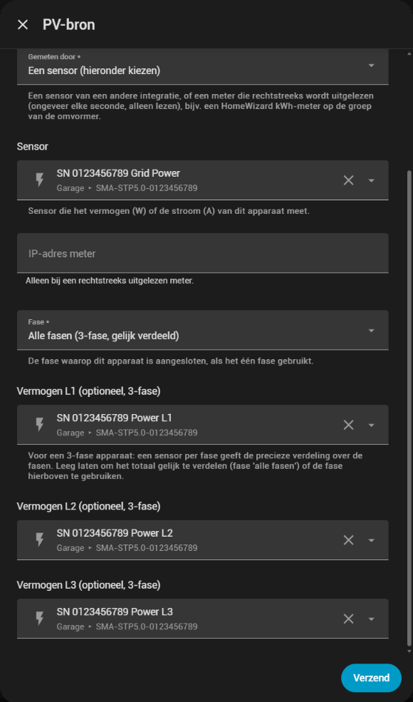](screenshots/config-pv-source-2.png)

### Excluded device

### Heating/cooling

 

### Time slot

 

